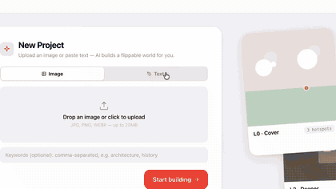

# flipbook-builder

English · **[中文](./README.md)**

[](./LICENSE)
[](https://github.com/yyb9807/flipbook-builder)
[](https://react.dev/)
[](https://fastapi.tiangolo.com/)
[](https://www.postgresql.org/)
[](https://docs.docker.com/compose/)
[](#)
[](#)

> **Give any image the power of "click forever to dive deeper".** Like [Flipbook](https://flipbook.page/), but you can save, edit, and export.

[Flipbook](https://flipbook.page/)'s "click anywhere to go anywhere" pixel-stream exploration is fun, but it's view-only — once you're done, it's gone. This project keeps the same interaction but turns every layer into a **persistent, editable structure**:

- AI auto-picks one of 4 compositions by content (map / plate / scene / diagram)
- Named hotspots — drag, rename, delete
- Projects live in Postgres, sync across devices
- Export offline ZIP / JSON / public share link



---

## Architecture

```
┌──────────── Browser ────────────┐
│  React 19 + Vite + Zustand      │   ← state, SSE, i18n (zh/en)
└────────────┬────────────────────┘
             │ /api/*  /uploads/*
┌────────────▼────────────────────┐
│  nginx (static + proxy + SSE)   │
└────────────┬────────────────────┘
             │
┌────────────▼────────────────────┐    ┌──────────────────┐
│  FastAPI + uvicorn              │ ─► │  Postgres 16     │
│  • input_analysis               │    │  (projects/nodes)│
│  • composition (map/plate/…)    │    └──────────────────┘
│  • image_generation (cached)    │
│  • hotspot_localization         │    ./data/
│  • SSE streaming                │ ─► uploads/  img_cache/
└─────────────────────────────────┘
        │
        ├─► Anthropic / OpenAI / OpenRouter (text + vision LLM)
        └─► DALL-E 3 / Flux / GPT-Image (image generation)
```

### Multi-agent pipeline

The backend splits "understand → plan → render → annotate" into 5 single-responsibility agents, chained into an SSE stream:

```
User input (image / text / keywords)
        │
        ▼
┌─────────────────────┐
│ input_analysis      │  Vision LLM reads input → summary / scene_type / keywords
└─────────┬───────────┘
          │
          ▼
┌─────────────────────┐
│ composition         │  Routes by content type to 1 of 4 prompt templates:
│   • map             │
│   • plate           │  ← prose-style, DALL-E 3 friendly
│   • scene           │
│   • diagram         │
└─────────┬───────────┘
          │
          ▼
┌─────────────────────┐
│ page_generation     │  LLM writes title / description / sub-hotspots per page
└─────────┬───────────┘
          │
          ▼
┌─────────────────────┐
│ image_generation    │  DALL-E 3 / Flux + SHA256 cache (skip API on identical prompt)
└─────────┬───────────┘
          │
          ▼
┌─────────────────────┐
│ hotspot_localization│  Vision LLM marks clickable regions ([0,1] bbox) on the rendered image
└─────────────────────┘
```

All agents extend a shared `BaseLLMAgent` that handles Anthropic / OpenAI-compatible protocols, prompt caching, retries, and SSE progress events.

**Key designs:**
- **Prompt caching**: same system prompt within 5 min hits cache. When generating 4 sub-pages in parallel, only the first call pays full price.
- **Image cache**: identical (model, prompt) hits local disk SHA256, skips API.
- **Composition routing + prose prompts**: 5–7 descriptors in natural prose, positive descriptions only (no "MUST/NOT" — DALL-E 3 doesn't respect them).
- **Provider abstraction**: users paste a key in the browser to use Anthropic / OpenAI / OpenRouter / DeepSeek / any OpenAI-compatible relay.

---

## Deploy

### One-shot (recommended)

```bash
git clone <repo>
cd flipbook_builder
docker compose up -d --build
```

Open http://localhost:8080 → click "Settings" top-right → paste your API Key → upload an image.

### Services

| Container | Image | Port | Role |
|---|---|---|---|
| `flipbook-frontend` | nginx:1.27-alpine | 8080→80 | Static + `/api` `/uploads` proxy + SSE long-poll |
| `flipbook-backend` | python:3.13-slim | 8000 (internal) | FastAPI + uvicorn |
| `flipbook-db` | postgres:16-alpine | 5434→5432 | Project data |

Volumes:
- `./data/` — uploaded + cached images (host-persisted)
- `postgres_data` — database (docker volume)

### Common commands

```bash
docker compose logs -f backend   # tail logs
docker compose ps                # status
docker compose down              # stop (keep data)
docker compose down -v           # stop + wipe everything
```

### Local dev (no containers)

```bash
# Backend
cd backend && python -m venv .venv && source .venv/bin/activate
pip install -r requirements.txt
uvicorn main:app --port 8000 --reload

# Frontend
cd frontend && npm install && npm run dev
```

A local Postgres (default `localhost:5434`) is required — run `docker compose up db` to start just the DB.

---

## Honest comparison

| Dimension | [Flipbook](https://flipbook.page/) (Zain Shah) | [openflipbook](https://github.com/eren23/openflipbook) (eren23) | **This project** |
|---|---|---|---|
| **Form** | Pure pixel stream, no DOM | Same as Flipbook (Next.js shell) | Structured pages + editable hotspots |
| **Generation** | LTX Studio video model (live stream) | fal-ai LTX video (~$0.02/page) | DALL-E 3 / Flux / GPT-Image (per image) |
| **Interaction** | Click anywhere to generate next page | Same | Click named, AI-detected hotspots |
| **Composition** | Single style (dreamy roam) | Same | 4 compositions auto-routed by content |
| **Editable** | ❌ read-only | ❌ read-only | ✅ drag, rename, delete, pick-to-expand |
| **Persistence** | Server session | Mongo + Cloudflare R2 | Postgres + local disk volume |
| **Export / share** | ❌ | Link (`/n/:id`) | ZIP / JSON / public share link |
| **Project mgmt** | ❌ | ❌ | ✅ list, thumbnails, delete, cross-device |
| **Backend** | Modal serverless GPU | Modal + R2 + Mongo | FastAPI + Postgres (self-host friendly) |
| **i18n** | English | English | Chinese / English |
| **Positioning** | Dreamy visual roam | Open clone of Flipbook | Structured visual knowledge tool |

In short: Flipbook / openflipbook are like **TikTok** (endless feed, vibe-driven). This project is like **Notion** (structured, editable, exportable — meant to leave behind a knowledge asset).

---

## Roadmap

- **v0.2** — Sub-page preloading (silently generate L2 candidates while user reads L1)
- **v0.3** — Flipping transitions via image-to-video model (LTX et al.) to fix static-image stiffness
- **v0.4** — Knowledge tools: ask the current node, cross-node search, export as Anki deck
- **v0.5** — Real-time multi-user: cursors + comments + node review
- **v0.6** — One-click deploy to Vercel / Fly.io / self-hosted docker-compose (with HTTPS)

---

## Contact

Interested in implementation details, collaboration, or similar problems? Reach out:

📧 yyb980716@gmail.com  
🐙 [github.com/yyb9807](https://github.com/yyb9807)

Issues / PRs welcome.

---

## License

MIT — fork / modify / commercialize freely under the LICENSE terms.

Credits: [Zain Shah](https://x.com/zainhda) (Flipbook), [eren23](https://github.com/eren23) (openflipbook), and the "layered visual knowledge" tradition of [David Macaulay](https://en.wikipedia.org/wiki/David_Macaulay) and DK Eyewitness.
