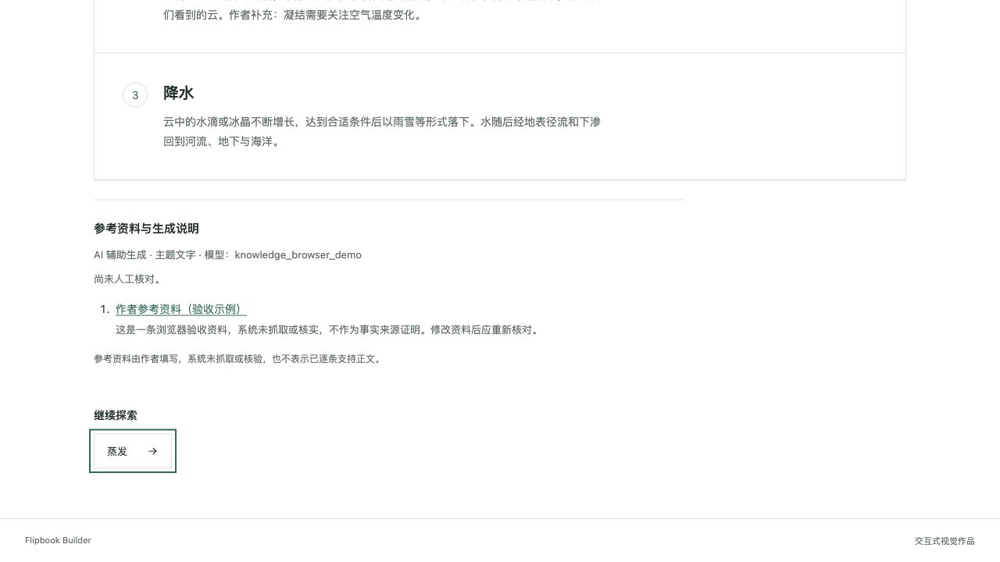

# Flipbook Builder

A self-hosted visual knowledge workspace with no account required. Connect topics, images and explanations into branching projects, edit their content, then export for readers.

[中文](README.md) · [Documentation](docs/README.md) · [Architecture](docs/ARCHITECTURE.md) · [Verification](docs/VERIFICATION.md)

## Try it without AI or a backend

Use Node.js 24:

```sh
cd frontend
npm ci
npm run dev
```

Open the URL printed by Vite, usually http://localhost:5173. Explore the four-page water-cycle example and edit a local copy. Write knowledge pages, add child pages directly from sections, annotate PNG/JPEG/WebP images, preview and export.

Local projects live in this browser; export before clearing site data. Manual local images are limited to 2 MB. Creation inputs and page-content drafts survive navigation and reloads. Save page drafts before previewing or exporting; uncreated file selections stay only for the current session.

## Self-host the AI workflow

With Docker Compose installed:

```sh
cp .env.example .env
docker compose up -d --build
```

Open http://localhost:8080. The default binding is localhost. nginx serves React and proxies FastAPI; Postgres stores server projects and `data/` holds images.

Configure a content provider in AI settings. Topic creation and new child pages generate editable knowledge content; illustrations require an explicit choice and an image provider. Uploaded images retain actual image hotspots. The content model must support the required text/vision input. Invalid knowledge output fails explicitly, without fabricated content or automatic paid retries.

Keys stay in page memory by default. Explicitly remembering a key stores it as plain text in browser storage. AI requests send credentials through this instance’s backend to the selected provider; ordinary editing, project and export requests do not send model keys. Endpoint, model and key form one configuration group, so a client endpoint never inherits a deployment key. Connection tests use unsaved drafts; text probes may cost money and image probes do not generate an image.

**This is one shared workspace with no login, roles or user isolation, intended for a personal or trusted environment.** Users bring their own keys; deployment defaults are also supported. A read-only viewer route is not an API access boundary. Share exported static projects with public readers. Run one backend worker and one replica.

## Editing, recovery and attribution

- **Two content modes:** knowledge-page sections connect to child pages; image hotspots use actual image coordinates. The editor, online viewer and offline player share one rendering core.
- **Durable jobs:** root analysis, child generation and eligible single-page regeneration use Postgres/DBOS. Reloads, disconnections and settings navigation do not cancel work. Completed stages are reused; lost temporary keys require explicit resumption. Unknown provider outcomes pause for review before a potentially billable retry.
- **Draft protection:** save status remains visible, successful branches are kept, and active jobs lock the project. Pages with hotspots or structured content cannot be regenerated wholesale, preserving authored text and relationships.
- **Author review:** generated pages record input type and model. Authors may add references and declare a review; changing content, references or hotspot labels clears that declaration. References are author-supplied, with no fetching, statement-level attribution or automatic fact verification. Model-generated citations are ignored.



## Preview and export

| Format | Contents and requirements |
|---|---|
| Offline ZIP | Shared player, images and project data. Extract the whole folder and open `index.html`; no backend, account or key is required. |
| JSON | Project content, structure and attribution, without image binaries or provider settings. |
| Instance link | Read-only interface requiring a running instance. It reads current project data, not an immutable publication snapshot. |

Keep the ZIP files together. Publish the entire extracted folder as static files. Actual browser acceptance covers HTTP playback; the independent player verifier covers JSDOM file URLs. Cross-browser acceptance of double-clicked `file://` files remains pending.

## Development and verification

Use Node.js 24, Python 3.13 and Postgres 16. For the frontend:

```sh
cd frontend
npm run lint
npm test
npm run verify:player
npm run build
```

See [backend development](backend/README.md), [current architecture](docs/ARCHITECTURE.md) and [verification commands and limits](docs/VERIFICATION.md). CI runs frontend checks, real Postgres backend tests and process recovery verification using controlled providers, with no paid model calls.

Back up the database and `data/`; `docker compose down -v` removes database volumes. [Historical reports](docs/archive/README.md) are retained for traceability, not as current setup instructions.

## Contributing and license

Please read [CONTRIBUTING.md](CONTRIBUTING.md) and [SECURITY.md](SECURITY.md). The project uses the [MIT license](LICENSE); referenced third-party projects retain their own licenses.
