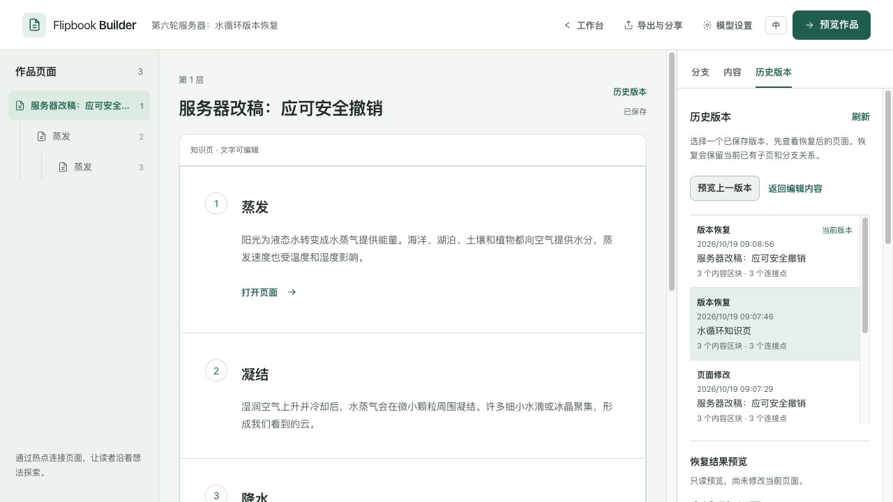

# Flipbook Builder

免账号、自托管的视觉知识工作台。把主题、图片与解释组织成可点击的分支作品，编辑和校正内容，再导出给读者。

[English](README.en.md) · [文档导航](docs/README.md) · [当前架构](docs/ARCHITECTURE.md) · [验证说明](docs/VERIFICATION.md)

## 先体验，无需模型或后端

使用 Node.js 24：

```sh
cd frontend
npm ci
npm run dev
```

打开终端显示的地址（通常为 http://localhost:5173），即可：

- 浏览「一滴水的旅程」四页示例，创建可编辑副本。
- 手动编写知识页，编辑标题、导读、内容区块和版式，直接添加子页。
- 标注 PNG/JPEG/WebP 图片，拖动或用方向键校正热点。
- 预览、导出离线 ZIP 或作品 JSON。

本地作品保存在当前浏览器，清除网站数据会删除作品与历史，请及时导出备份。手动本地图片限制为 2 MB。创作输入和页面内容草稿可跨页面及刷新保留；页面草稿保存后才能预览和导出。「撤回本次修改」只清除当前页未保存草稿，保留其他页面草稿。尚未创建的文件选择仅在本次会话保留。

## 自托管完整 AI 流程

需要 Docker Compose：

```sh
cp .env.example .env
docker compose up -d --build
```

访问 http://localhost:8080；独立阅读服务默认在 http://localhost:8081。两者默认仅绑定本机；nginx 提供编辑前端并代理 FastAPI，Postgres 保存服务器作品，图片和发布文件位于 `data/`。

进入「模型设置」配置内容模型。文字主题和新子页生成可编辑的知识正文，插图是明确可选项；上传图片则保留原图与真实图像热点。内容模型需要支持相应的文字/看图输入，选插图时还需图片服务配置。格式不合法会明确失败，不伪造正文或自动重新付费调用。

Key 默认只在页面内存保存；选择「在此浏览器记住密钥」后才明文写入浏览器存储。AI 请求将 Key 发到此实例后端，再调用所选供应商；普通作品、编辑和导出请求不带模型凭据。地址、模型和 Key 按组使用，不把客户端地址与部署者 Key 混配。设置中的测试使用未保存草稿，文字探活可能收费，图片测试不实际出图。

**编辑器是免登录、无角色和无用户隔离的单共享实例，适合个人或受信任环境。** 默认用户自备 Key，也支持部署者提供默认配置。公开读者使用独立发布服务或导出的静态作品；不要公开编辑服务。编辑后端仅支持一个 worker/副本。

## 编辑、恢复与来源

- **两种内容**：知识页的正文区块连接子页，图片热点按实际图像坐标导航。编辑器、在线阅读和离线播放器共用渲染核心。
- **持久任务**：根页分析、子页生成和单页再生使用 Postgres/DBOS；刷新、断线和进入设置不会取消。完成的阶段可复用，临时 Key 丢失时等待显式补充；结果不明时暂停，重试前确认可能重复计费。
- **保护编辑**：草稿与保存状态可见，成功分支逐页保留。活动任务期间作品暂锁；已有热点或结构化正文的页面不允许整页再生，以保护作者内容和关系。
- **页面历史**：已保存的正文、资料、热点和生成结果可从「历史版本」查看。先预览恢复后的实际合并页面，再确认恢复；当前连接目标、子页和后代关系保留，旧版没有的已连接区块也保留。有内容变化的恢复会追加版本，恢复前的内容仍可找回；恢复后需重新人工核对。
- **作者核对**：生成说明记录输入类型和模型，作者可添加参考资料与核对声明；正文、资料或热点文字变化会清除旧声明。资料由作者填写，系统不抓取、不逐句关联或自动核实事实，也不采纳模型编造的引用。



本地历史每页保留最近 50 个版本，和作品在同一浏览器存储条目提交；空间不足时保留原有已存内容与历史。服务器历史保存在 Postgres，不主动裁剪。生成、保存或任意页面草稿待处理时暂不恢复。跨标签冲突会保留当前修改，需明确重新载入最新保存的整份作品；这不是多人协作协议。历史不替代数据库和图片备份，删除作品会一并删除历史。

## 阅读与导出

| 方式 | 包含内容与运行条件 |
|---|---|
| 固定版本发布 | 服务器保存整份作品、分支、图片和阅读器；独立服务只读提供，每次发布生成新链接，后续编辑、恢复、删除原作或升级不改变旧内容 |
| 离线 ZIP | 共享播放器、图片与作品数据；解压整个文件夹后打开 `index.html`，无需后端、账号或 Key，不含页面历史 |
| JSON | 作品内容、结构和来源；不包含图片二进制、模型配置或页面历史 |
| 当前实例链接 | 只读界面，需要实例在线；读取当前作品，不是固定版本的发布快照 |

服务器作品从「导出与分享 → 发布固定版本」发布，作品库「发布记录」也能管理已经删除原作的发布。先完成保存、所有页面草稿和生成任务；陈旧修订明确拒绝。撤下后链接失效，已经下载的副本无法追回。任何获得链接的人都能阅读，随机地址不是私密权限。

分享给其他设备时，将 `PUBLICATION_BASE_URL` 改为独立阅读服务可访问的 HTTPS 地址，并按部署环境设置 `READER_BIND` / `READER_PORT`。仅向读者公开 reader 端口，保留编辑端口的可信网络边界。独立服务仅挂载 `data/publications/` 只读，不需要 Postgres、AI Key 或编辑 API；发布目录必须单独保留和备份。本地作品仍以离线 ZIP 分享。

不要只移动 ZIP 中的 HTML。静态公开发布可上传整个解压目录。实际浏览器验收覆盖 HTTP 播放，独立播放器验证覆盖 JSDOM file URL；真实浏览器双击 `file://` 的跨浏览器验收仍待补充。

## 开发与验证

使用 Node.js 24、Python 3.13、Postgres 16。[前端说明](frontend/README.md)介绍共享渲染器、浏览器状态与构建；[后端说明](backend/README.md)提供本地启动、配置和 API 合约；[当前架构](docs/ARCHITECTURE.md)描述模块与任务数据流。

所有检查命令、最近本地结果和未覆盖范围统一见[验证说明](docs/VERIFICATION.md)。GitHub Actions 配置包含前后端检查、真实 Postgres 测试和进程恢复验证，模型测试使用受控供应商，无付费调用；远端 CI 结果以对应提交的实际运行为准。

备份数据库和 `data/`；`docker compose down -v` 会删除数据库卷。[历史计划与审查](docs/archive/README.md)用于追溯，不作为当前运行指南。

## 贡献与许可

欢迎可复现的问题报告与改进。请先阅读[贡献说明](CONTRIBUTING.md)和[安全说明](SECURITY.md)。项目采用 [MIT](LICENSE)；参考研究中的第三方项目保留各自许可。
