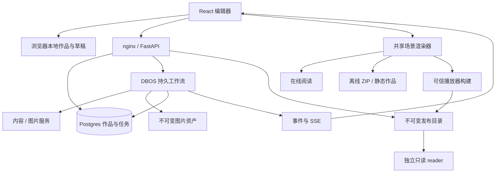

# 当前架构

更新于 2026-10-19。本文描述已实现的结构；历史选型依据见[架构研究](archive/ARCHITECTURE_RESEARCH.md)。产品范围见 [PRODUCT.md](../PRODUCT.md)。

## 运行形态

- **浏览器本地模式**：React/Vite 应用直接运行示例、手动知识页和图片标注。本地作品、页面历史、创作草稿、模型设置保存在当前浏览器；作品与其历史共用一个存储条目，草稿和设置独立。
- **服务器模式**：nginx 提供前端并代理 FastAPI；Postgres 保存作品、页面版本、恢复幂等记录、任务和 DBOS 检查点；本地 `data/` 保存规范化图片及缓存。
- **离线作品**：共享 React 播放器构建为普通脚本，和公开作品快照、图片一起打包；阅读无需 API、账号或 Key。
- **固定版本发布**：编辑后端从服务器作品创建不可覆盖的文件快照；独立 `reader:app` 只读挂载发布目录，不需要数据库、模型或编辑接口。内容和阅读器一同冻结，删除原作品不删除发布。

编辑器是无登录、无角色、无用户隔离的单共享实例。`/v/{projectId}` 是当前实例阅读界面，不是编辑 API 的权限边界。默认端口绑定 localhost；公开读者使用独立 reader 或导出的静态作品。编辑后端只允许一个 Uvicorn worker 和一个副本，以 Postgres advisory lock 拒绝第二个执行器。

## 代码入口

| 路径 | 职责 |
|---|---|
| `frontend/src/pages/` | 首页、编辑器、根页任务、阅读与模型设置 |
| `frontend/src/components/scene/` | 知识页/图片共享渲染、热点编辑和阅读导航 |
| `frontend/src/components/builder/` | 内容/资料编辑器、页面历史面板、目录、热点与任务面板 |
| `frontend/src/hooks/` | 编辑保存队列、草稿保护、版本恢复、持久任务发现与订阅 |
| `frontend/src/store/` | 本地/服务端作品、草稿、任务与凭据状态 |
| `frontend/src/utils/offlineExport.ts` | 公开字段快照、图片打包与离线导出 |
| `frontend/scripts/` | 独立播放器构建及实际产物验证 |
| `backend/agents/` | 内容分析、知识合约、分支规划、出图和真实定位 |
| `backend/jobs/` | DBOS 工作流、调用意图、业务状态、凭据 vault 与恢复 |
| `backend/routers/` | 作品、页面、热点和任务 HTTP API |
| `backend/content_metadata.py` | 来源、作者资料、人工核对与地址校验 |
| `backend/version_history.py` / `backend/routers/versions.py` | 页面内容白名单快照、连接保护合并、版本读取与原子恢复 |
| `backend/storage.py` / `backend/schema.sql` | 图片存储、可重复应用的表结构和迁移 |
| `backend/publications.py` / `backend/routers/publications.py` | 整树校验、白名单快照、原子发布、私有回执和撤下 |
| `backend/reader.py` / `backend/publication_files.py` | 无数据库依赖的独立只读文件服务与路径白名单 |
| `scripts/` | 当前进程恢复与整栈验收入口 |

## 两种内容模式

知识页使用 `scene_document` v1，包含 `atlas` 或 `sequence` 版式与可编辑区块。手动编辑最多 12 区块；新 AI 输出严格要求 1–6 个有解释正文的区块。区块与导航连接由后端原子保存，真实连接 ID 回填客户端；已有子页的区块不能直接删除或改指目标。

`kind=section` 是内容区块连接，位置、尺寸和评分为 null。`kind=image` 是真实图片上的几何热点，可拖动或键盘校正。两者共用导航，但不将区块布局假装成模型定位。

从主题创建、新子页和符合条件的旧空白页再生，使用同一次分析/规划调用输出知识正文，可明确选择插图；插图不触发额外热点定位。上传图片保留原图模式与真实视觉分析。无效知识输出明确失败，不补伪造正文或自动再付费调用。已有热点或结构化正文的页面拒绝整页再生，以保护作者内容与关系。

## 持久任务与凭据

根页分析、子页生成、单页再生提交后返回 `202 + snapshot`。业务任务与 DBOS 入队在同一 Postgres 事务中完成；规划、可选出图、旧图像定位和本地提交按阶段 checkpoint。正文、来源、连接和父子关系以短事务幂等保存。一个分支失败不会删除已完成页面。

浏览器只订阅状态，刷新、断线或进入设置不会取消任务。操作 ID 用于找回丢失的提交响应；终态重新读取完整项目，避免用局部事件覆盖新草稿。一个项目的新活动任务互斥，期间编辑被锁定。取消是显式操作，不能撤销供应商已经收到的请求或费用。

Key 默认仅在前端内存中；作者明确选择记住后才明文写入浏览器存储。普通作品、读取和导出请求不带模型凭据。服务端临时 vault 保存 Key（30 分钟 TTL、最多 100 份），工作流只携带引用，重启后需要显式补 Key。供应商地址、模型、Key 整组选择，客户端地址不混用部署者 Key。

外部调用只尝试一次。已发出请求但结果未持久化时进入待确认，不静默重试收费操作；作者可在支持时保留已有结果、明确确认重试或取消。DBOS 的 Base64 序列化不是加密。新任务冻结 `knowledge-v1` / `image-v1`，无标记旧任务保留旧步骤路径；这不是任意跨版本工作流迁移保证。

API 路径、请求字段与特殊恢复边界见[后端说明](../backend/README.md)。

## 草稿、页面版本与并发

未保存的内容草稿按作品/页面隔离。「撤回本次修改」只清除当前页对应草稿；确认过程中若草稿已改变，不清除后来输入，其他页面草稿不受影响。原生输入撤销仍由浏览器处理。这与恢复已保存版本是不同操作。

服务器在页面编辑、资料核对、热点文字/几何变化及生成内容提交的同一业务事务中保存内容版本；子页生成同时记录父页连接和新子页。内容哈希忽略热点选择，纯选择仍推进项目修订号，但不产生正文版本；相同内容不重复留版。旧项目在首次读取历史或内容变更前惰性补一份当前基线。`node_versions` 只保存页面公开字段：标题、说明、内容模式、项目内图片引用、白名单正文、来源与热点；没有整棵树、任务状态、原始输入、Key 或供应商连接。Postgres 历史不主动裁剪。

版本详情 API 返回真实恢复合并结果作为只读预览。历史内容与当前连接按稳定热点身份合并，当前目标优先，旧目标不能复活或替换当前目标；历史中缺失的已连接区块/热点被保留。恢复只写当前页内容、资料与热点，保留父节点、层级、运行状态、子页和后代子树。合并超过 12 区块/热点、保留分支缺少正文或服务器图片资产缺失时，整次恢复拒绝。恢复不会调用模型；有内容变化时追加版本，恢复前内容仍在历史中，并将核对状态重置为 `unreviewed`。服务器历史中的旧生成说明可以恢复，但它仍是页面级说明；保留的新区块与旧内容混合后没有区块级出处。

项目 `revision` 用于乐观并发控制。普通页面/热点写入的 `expected_revision` 可选以兼容旧客户端，新编辑器均携带当前确认修订；恢复强制携带非负修订号和 `operation_id`。服务端锁定项目、校验归属和活动任务，并原子提交恢复、版本、修订号及幂等回执。相同恢复操作重放返回原回执；前端随后读取最新整份项目，避免旧回执覆盖后来编辑。陈旧修订返回 409，不自动重试覆盖。作者明确选择「重新载入已保存页面」后读取最新整份作品，再重新选择预览；存在保存失败的乐观修改时，先成功保存本地恢复副本，读取成功后才清除待同步记录。活动任务、待保存/失败写入或任意页面草稿存在时不允许恢复。

本地 `libraryStore` 将作品与每页最近 50 个版本通过同一次 `localStorage.setItem` 提交。序列化或配额失败不替换已持久保存的旧作品/历史，也不清草稿；版本不重复保存图片 data URL，恢复继续使用当前图片。本地写入前重读修订可发现已观察到的跨标签冲突，但 localStorage 跨进程没有 compare-and-swap，无法保证同时写入的全局串行化，也不构成多人协作协议。页面历史仅用于编辑恢复，不进入公开 JSON、ZIP 或播放器；删除作品会删除对应历史，数据库与图片仍需另行备份。

## 来源与发布

节点级 `content_metadata` v1 包含服务端生成说明（输入类型、模型）、最多 12 条作者参考资料和作者核对声明。编辑 API 不允许伪造、修改或移除服务端生成说明；不采纳模型提供的引用或核实声明。资料地址仅允许无凭据的绝对 HTTP(S)，前后端和阅读器均校验。

作者资料不表示系统访问过网页或核实过事实，也没有逐句来源关联。正文、资料或热点文字变化使旧核对失效；纯选择或几何变化保留声明。旧作品不补造出处。

编辑器、在线阅读和离线播放器复用共享渲染核心。公开快照按白名单保留作品内容、关系和来源，排除 Key、供应商地址、原始输入、任务内部状态和页面历史。JSON 不含图片二进制；ZIP 包含图片和无需 JSON fetch / ES module 的普通脚本播放器。实例链接依赖当前实例及当前数据，不是固定版本快照。后端 ZIP 保留兼容文本/链接降级视图，前端 ZIP 使用共享播放器。

服务器固定发布在项目写锁下校验 `expected_revision` 和活动任务，检查唯一根、完整可达树、父子/层级、连接与正文一致；1–1000 页。严格选择公开字段，图片仅能引用本项目规范化 PNG，不抓取外网或其他项目图片，缺失时拒绝整次发布。内容 JSON 上限 16 MB，独立图片总量 200 MB；上限不是已完成压力测试的承诺。

Node 构建的可信 `player.js` / `player.css` 在发布时复制，图片按 SHA-256 文件名复制到快照 `assets/`。`data/publications/{pub_id}` 包含固定 HTML、JSON、JS/CSS 和图片；私有 `manifest.json` 记录源项目/修订、操作 ID、时间、页数和全部公开文件的聚合哈希。没有依赖源项目外键的发布 SQL 表。跨进程文件锁串行同项目发布/撤下，隐藏暂存目录完成所有校验与拷贝后原子 rename 公开；正常失败清理暂存。进程被强制终止可能留隐藏暂存，读者不可访问，管理员可在停编辑服务后清理。

同操作 ID 和原修订返回既有回执，参数不同返回 409；后续新发布使用新 ID 和链接，旧目录不覆盖。发布不推进项目修订，也不修改页面核对声明。草稿、失败/待保存写入、恢复或生成期间前端阻止发布，服务端仍独立校验真实修订和任务。未知网络结果在 sessionStorage 保留原操作和修订，明确重试同一次发布；不把新的编辑状态悄悄发布。

撤下将目录原子移入私有 `.withdrawn/`，删除公开文件，保留幂等凭据，原操作重试不能复活旧链接。删除源作品仅删除源数据/图片/历史，不删除发布；首页全局发布记录仍能撤下。reader 仅提供白名单 GET/HEAD 和 `/healthz`，不导入编辑应用/DBOS、不加载 `.env`、不创建目录；Compose 使用非 root、只读根目录和只读发布挂载。私有清单、隐藏目录、符号链接和编辑 API 不可读。响应 `no-store` 使后续请求重新核对，但无法追回已经渲染或下载的副本。

部署者配置 `PUBLICATION_BASE_URL`，只公开 reader 服务，并备份数据库、源图片及发布目录。默认 localhost 链接只能本机打开；独立服务仍需在线。随机链接是可转发的公开地址，不是身份权限。本轮不接受客户端上传本地项目、HTML 或脚本，本地作品继续离线 ZIP。

## 运行与演进边界

当前没有独立任务集群、用户权限、检索/向量库、图数据库、通用画布或协作协议。草稿撤回、页面版本恢复和独立只读发布已实现；真实模型质量、长期负载、跨浏览器/辅助技术和跨版本任务迁移需另行验收。最新证据及复测命令见[验证说明](VERIFICATION.md)。
