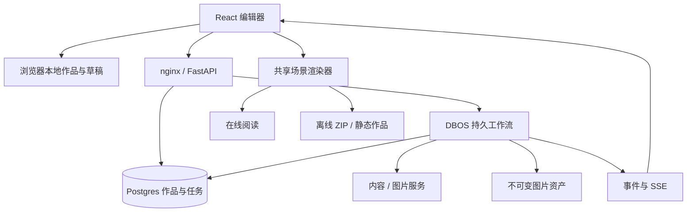

# 当前架构

更新于 2026-10-18。本文描述已实现的结构；历史选型依据见[架构研究](archive/ARCHITECTURE_RESEARCH.md)。产品范围见 [PRODUCT.md](../PRODUCT.md)。

## 运行形态

- **浏览器本地模式**：React/Vite 应用直接运行示例、手动知识页和图片标注。本地作品、创作草稿、模型设置各用独立 store；作品保存于当前浏览器。
- **服务器模式**：nginx 提供前端并代理 FastAPI；Postgres 保存作品、任务和 DBOS 检查点；本地 `data/` 保存规范化图片及缓存。
- **离线作品**：共享 React 播放器构建为普通脚本，和公开作品快照、图片一起打包；阅读无需 API、账号或 Key。

这是无登录、无角色、无用户隔离的单共享实例。只读查看路由是阅读界面，不是编辑 API 的权限边界。默认端口绑定 localhost；公开读者使用导出的静态作品。部署只允许一个 Uvicorn worker 和一个后端副本，以 Postgres advisory lock 拒绝第二个执行器。

## 代码入口

| 路径 | 职责 |
|---|---|
| `frontend/src/pages/` | 首页、编辑器、根页任务、阅读与模型设置 |
| `frontend/src/components/scene/` | 知识页/图片共享渲染、热点编辑和阅读导航 |
| `frontend/src/components/builder/` | 内容/资料编辑器、目录、热点与任务面板 |
| `frontend/src/hooks/` | 编辑保存队列、草稿保护、持久任务发现与订阅 |
| `frontend/src/store/` | 本地/服务端作品、草稿、任务与凭据状态 |
| `frontend/src/utils/offlineExport.ts` | 公开字段快照、图片打包与离线导出 |
| `frontend/scripts/` | 独立播放器构建及实际产物验证 |
| `backend/agents/` | 内容分析、知识合约、分支规划、出图和真实定位 |
| `backend/jobs/` | DBOS 工作流、调用意图、业务状态、凭据 vault 与恢复 |
| `backend/routers/` | 作品、页面、热点和任务 HTTP API |
| `backend/content_metadata.py` | 来源、作者资料、人工核对与地址校验 |
| `backend/storage.py` / `backend/schema.sql` | 图片存储、可重复应用的表结构和迁移 |
| `scripts/` | 当前进程恢复与整栈验收入口 |

## 两种内容模式

知识页使用 `scene_document` v1，包含 `atlas` 或 `sequence` 版式与可编辑区块。手动编辑最多 12 区块；新 AI 输出严格要求 1–6 个有解释正文的区块。区块与导航连接由后端原子保存，真实连接 ID 回填客户端；已有子页的区块不能直接删除或改指目标。

`kind=section` 是内容区块连接，位置、尺寸和评分为 null。`kind=image` 是真实图片上的几何热点，可拖动或键盘校正。两者共用导航，但不将区块布局假装成模型定位。

从主题创建、新子页和符合条件的旧空白页再生，使用同一次分析/规划调用输出知识正文，可明确选择插图；插图不触发额外热点定位。上传图片保留原图模式与真实视觉分析。无效知识输出明确失败，不补伪造正文或自动再付费调用。已有热点或结构化正文的页面拒绝整页再生，以保护作者内容与关系。

## 持久任务与凭据

根页分析、子页生成、单页再生提交后返回 `202 + snapshot`。业务任务与 DBOS 入队在同一 Postgres 事务中完成；规划、可选出图、旧图像定位和本地提交按阶段 checkpoint。正文、来源、连接和父子关系以短事务幂等保存。一个分支失败不会删除已完成页面。

浏览器只订阅状态，刷新、断线或进入设置不会取消任务。操作 ID 用于找回丢失的提交响应；终态重新读取完整项目，避免用局部事件覆盖新草稿。一个项目的新活动任务互斥，期间编辑被锁定。取消是显式操作，不能撤销供应商已经收到的请求或费用。

Key 默认仅在前端内存中；作者明确选择记住后才明文写入浏览器存储。普通作品、读取和导出请求不带模型凭据。服务端临时 vault 保存 Key（30 分钟 TTL、最多 100 份），工作流只携带引用，重启后需要显式补 Key。供应商地址、模型、Key 整组选择，客户端地址不混用部署者 Key。

外部调用只尝试一次。已发出请求但结果未持久化时进入待确认，不静默重试收费操作；作者可在支持时保留已有结果、明确确认重试或取消。DBOS 的 Base64 序列化不是加密。新任务冻结 `knowledge-v1` / `image-v1`，无标记旧任务保留旧步骤路径；这不是任意跨版本工作流迁移保证。

API 路径、请求字段与特殊恢复边界见[后端说明](../backend/README.md)。

## 来源与发布

节点级 `content_metadata` v1 包含服务端生成说明（输入类型、模型）、最多 12 条作者参考资料和作者核对声明。编辑 API 不允许伪造、修改或移除服务端生成说明；不采纳模型提供的引用或核实声明。资料地址仅允许无凭据的绝对 HTTP(S)，前后端和阅读器均校验。

作者资料不表示系统访问过网页或核实过事实，也没有逐句来源关联。正文、资料或热点文字变化使旧核对失效；纯选择或几何变化保留声明。旧作品不补造出处。

编辑器、在线阅读和离线播放器复用共享渲染核心。公开快照按白名单保留作品内容、关系和来源，排除 Key、供应商地址、原始输入及任务内部状态。JSON 不含图片二进制；ZIP 包含图片和无需 JSON fetch / ES module 的普通脚本播放器。实例链接依赖当前实例及当前数据，不是固定版本快照。后端 ZIP 保留兼容文本/链接降级视图，前端 ZIP 使用共享播放器。

## 运行与演进边界

当前没有独立任务集群、用户权限、检索/向量库、图数据库、通用画布或协作协议。优先推进撤销、版本恢复与独立只读发布；真实模型质量、长期负载、跨浏览器/辅助技术和跨版本恢复需另行验收。最新证据及复测命令见[验证说明](VERIFICATION.md)。
