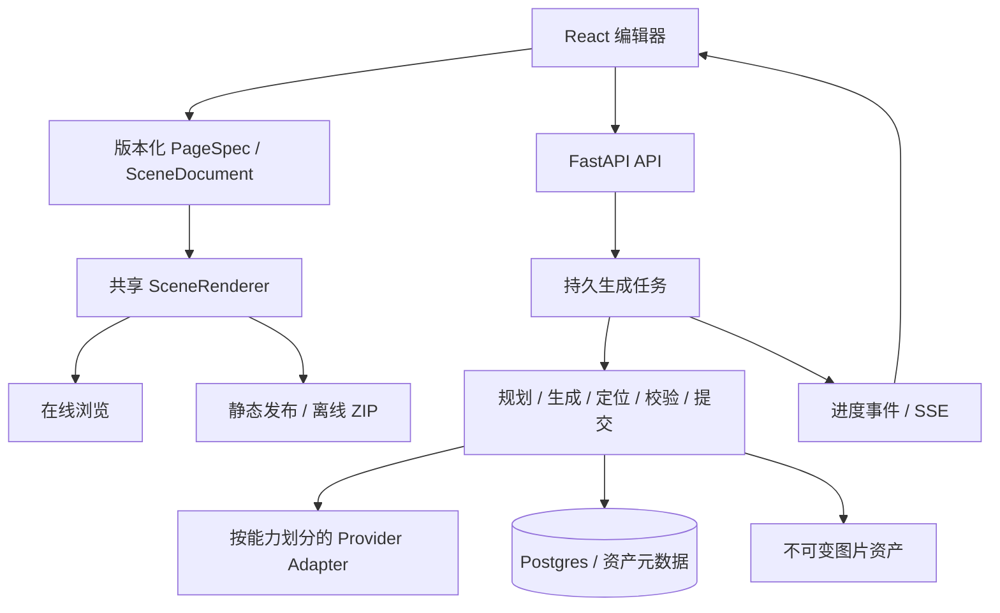

# 技术架构与同类项目研究

> 历史记录（2026-10-18）。本文保留当时状态；当前实现与可运行命令见[文档导航](../README.md)和[验证说明](../VERIFICATION.md)。旧 PoC / 36 场景 CLI 已退役。

> 这是基于 `6354b49` 的研究与建议。第一轮已落地的部分、隔离原型和未验收范围见[实施报告](IMPLEMENTATION_REPORT.md)；下文的目标结构仍用于说明后续方向。

检索日期：2026-10-18（Asia/Shanghai）
本地基线：`6354b49`
前置材料：[项目审查](PROJECT_AUDIT.md)

本轮研究官方 GitHub、关键源码、官方文档和许可证，并与当前实现对照。未运行外部项目的完整部署或付费生成，没有进行模型质量、成本或性能基准测试。以下“推荐”是结合本项目目标作出的工程判断，不是外部项目的性能排名。本轮只新增研究文档。

## 1. 结论与建议定位

建议保留 React / Vite、FastAPI、Postgres 和现有项目/节点/热点模型，把产品主线收敛为：**免账号、自托管、可人工校正、可引用来源、可离线发布的交互式视觉知识作品工具**。

最值得投入的架构升级依次是：

1. 页面由结构化内容驱动：文字、图片、热点、跳转和来源分别保存。
2. 知识模板页与自由场景采用不同生成流程，解决热点位置与实际内容不一致。
3. 生成任务独立于浏览器连接，保存步骤产物，支持恢复、取消和明确的失败状态。
4. 编辑器、浏览器、分享和离线导出共用渲染核心。
5. 模型接口按实际能力适配，明确区分新图生成、参考图编辑和区域编辑。

现有模块划分可继续使用。当前工作更接近固定的多阶段流水线，`composition.py` 本身就是确定性模板函数；为此立即引入完整多 Agent 编排、图数据库或分布式队列，收益尚不明确。

## 2. 同类项目给出的实际启发

### Flipbook 与 openflipbook：应更新现有认知

原版 Flipbook 的官方页面说明静态生成图片是主要形态，视频是实验性可选项。不能继续把它概括为“只有 LTX 实时视频流”。[Flipbook 官方页面](https://flipbook.page/)

openflipbook 当前已包含页内编辑、风格参考、地点身份编辑、引用、嵌入浏览和本地 Docker。当前仓库 README 中“只读、单一风格、只能链接分享、必须云服务”的比较需要改写。[当前官方仓库](https://github.com/eren23/openflipbook)

本轮源码核验固定于提交 `d64c27ea2120db055b726becfc28457fce329a6a`，仓库使用 MIT 许可。[许可证](https://github.com/eren23/openflipbook/blob/d64c27ea2120db055b726becfc28457fce329a6a/LICENSE)

| 参考实现 | 核验到的机制 | 对本项目的建议 |
|---|---|---|
| 点击解析和候选预计算 | VLM 接收真实图片与点击位置，返回对象/bbox；候选失败可以返回空结果 | 用于原图/场景模式，不能以固定网格假装对象定位 |
| 图像生成与图像编辑拆分 | 不同适配器处理 text-to-image 与真实参考图片输入 | 建立能力声明，不能假设给任何模型添加 reference 参数都有效 |
| 地点身份和风格 anchor | 持久化名称、别名、外观、参考裁切和保存视角 | 保留重要对象身份与父图裁切，重访直接复用旧资产 |
| 搜索引用抽取 | 从响应元数据提取 URL/title 并随结果保存 | 知识页记录来源；有引用不等于所有事实均被验证 |
| 数据 ZIP | 打包图片、图结构和引用资料 | 可以借鉴资产封装；本轮未确认它等同于离线可点击 HTML 播放器 |

对应固定版本源码：[点击解析](https://github.com/eren23/openflipbook/blob/d64c27ea2120db055b726becfc28457fce329a6a/apps/modal-backend/providers/llm/click.py#L176)、[参考图编辑](https://github.com/eren23/openflipbook/blob/d64c27ea2120db055b726becfc28457fce329a6a/apps/modal-backend/providers/image_edit.py#L79)、[新图端点适配](https://github.com/eren23/openflipbook/blob/d64c27ea2120db055b726becfc28457fce329a6a/apps/modal-backend/providers/image.py#L150)、[实体上下文](https://github.com/eren23/openflipbook/blob/d64c27ea2120db055b726becfc28457fce329a6a/apps/modal-backend/providers/llm/planner.py#L331)、[引用抽取](https://github.com/eren23/openflipbook/blob/d64c27ea2120db055b726becfc28457fce329a6a/apps/modal-backend/providers/llm/planner.py#L424)、[ZIP 导出](https://github.com/eren23/openflipbook/blob/d64c27ea2120db055b726becfc28457fce329a6a/apps/web/lib/export-build.ts#L104)。

**不建议直接换成它的整个架构。** 它仍以整张栅格图和空间探索为核心，本项目可以围绕可编辑知识内容、精确热点和轻量离线发布形成自己的取舍。若未来明确转向沉浸式世界探索，再评估基于它二次开发。参考图不能保证每次生成都保持对象一致，其自身也把严格一致性验证列为默认关闭的实验能力。[一致性边界说明](https://github.com/eren23/openflipbook/blob/d64c27ea2120db055b726becfc28457fce329a6a/docs/PLACE_IDENTITY.md)

### H5P：更适合学习内容与交互的分离

H5P Image Hotspots 将背景图、位置、标题、内容分开定义，热点有真实按钮实现；Branching Scenario 使用可保存的分支数据描述导航。两者仓库说明为 MIT。本项目可借鉴内容格式和播放器分离，无需把整套 H5P 运行环境接进来。[Image Hotspots](https://github.com/h5p/h5p-image-hotspots)、[内容 schema](https://github.com/h5p/h5p-image-hotspots/blob/master/semantics.json)、[热点按钮](https://github.com/h5p/h5p-image-hotspots/blob/master/scripts/hotspot.js)、[Branching Scenario](https://github.com/h5p/h5p-branching-scenario)

## 3. 首先改变生成方式

### 当前实现中的关键矛盾

- `backend/routers/nodes.py:20–35` 用 `_grid_hotspots` 把子主题固定排在 2×2 网格上，并统一写入 `score=0.8`。
- `_build_child` 生成图片后直接使用该网格，没有检查画中的对象实际位置。
- 子页内容仅接收父标题、描述与热点文字；`ImageGenerationAgent.generate` 接收纯文字 prompt，没有父图或裁切参考。
- prompt 经常描述 16:9，OpenAI 出图调用却固定 `1024x1024`。图片布局意图与输出参数没有统一契约。
- `storage.cache_key` 仅包含 model + prompt，未来支持参考图、尺寸、种子或不同服务端后会不足；同提示的“重新生成”也可能直接命中旧结果。

因此，升级模型或换 UI 框架无法单独保证“热点真的指向对象”“下一层延续上一层”。需要先定义页面的内容和空间规则。

### 建议保留两条清晰流程

| 模式 | 生成流程 | 优势 | 代价 |
|---|---|---|---|
| **结构化知识页，推荐默认** | 资料/主题 → 结构化 PageSpec → AI 插图 → 确定性 HTML/SVG 排版 → 已知坐标热点 | 文字可编辑/翻译/搜索；区域与内容一一对应；可复用模板 | 需要设计少量可靠模板；不会每页都是自由构图的大图 |
| **原图或自由场景** | 原图/参考图 → 看图识别或参考编辑 → 对实际图像定位 → 用户校正 | 保留照片、地图、场景探索的视觉自由度 | 定位可能失败，多一次模型调用；应允许待标注或手动定位 |

原图模式可先直接使用上传图，不必强制重新生成。原图细节放大与知识补充应明确区分，例如热点关系标记为 `detail`、`part`、`related`，避免每次“深入”都变成无关主题扩写。

知识页先落地两种模板即可，例如“分项图鉴”和“结构说明”。地图/自由场景继续采用真实定位。图表或机制图中的文字和连线由代码排版，更容易修正；AI 绘制的内容仍须校对，模板不自动保证事实正确。

`score=0.8` 不应展示成统一的 AI 置信度。建议保存 `origin: layout | model | manual`、`verified`，没有可靠评分时 `confidence=null`。

## 4. 推荐目标结构

下图是本项目的架构建议，尚未实现。



先保留现有树状节点，不需要图数据库。`PageSpec` 负责可渲染内容，关系数据库负责项目、版本、工作状态与查询。避免同时维护互不一致的 JSON 文档、热点表和前端缓存三份真相：编辑通过单一服务更新版本并生成发布快照。

建议逐步补充的数据概念：

| 对象 | 应记录的重点 |
|---|---|
| Page / Node | 标题、描述、版式类型、父关系、版本、资产引用、来源引用 |
| Hotspot | 标签、几何、目标页面、关系类型、自动/人工来源、校正状态 |
| Asset | 内容哈希、实际宽高、格式、相对地址、生成来源；图片文件不可变 |
| Generation | 输入版本、步骤结果、状态、供应商请求 ID、错误/成本信息；不含 Key |
| Publication | 某个版本的只读内容与资产清单，排除配置、凭据和未发布草稿 |

如果确实需要角色/地点跨多页保持一致，再引入轻量 Entity（名称、别名、外观描述、参考裁切）。不要一开始建立复杂世界模拟模型。

## 5. 前端选型：先建立一个可靠的渲染核心

**当前推荐 React + SVG 图像坐标系 + DOM 语义按钮。** 图片与区域共用天然尺寸对应的 `viewBox`，热点仍可沿用现有归一化存储，在渲染时统一换算；缩放/裁切同时作用于图片和热点。DOM 按钮通过同一变换定位，触控目标保持可用大小。SVG 规范中的坐标映射是该方案的基础。[W3C SVG 坐标规范](https://www.w3.org/TR/SVG/latest/coords.html)

`SceneRenderer` 只负责展示；`SceneEditor` 叠加选择、拖动、键盘微调和撤销。在线查看与离线包使用同一份 renderer 构建，逐步替换后端维护的独立 viewer HTML。

| 技术 | 何时值得采用 | 本轮判断 |
|---|---|---|
| [Annotorious React](https://annotorious.dev/react/image-annotation/) | 需要矩形/多边形区域创建和精确调整 | 最贴近标注需求的备选；当前少量点热点可先不加；[BSD-3 仓库](https://github.com/annotorious/annotorious) |
| [OpenSeadragon](https://openseadragon.github.io/) | 出现超大图、图像切片、IIIF 深缩放 | 普通 1024 级图片暂不需要；已有[覆盖物能力](https://openseadragon.github.io/examples/ui-overlays/) |
| [React Flow](https://reactflow.dev/) | 页面关系从简单树发展为需要可视化编辑的分支图 | 可作为“作品地图”，不承担图片热点渲染；有[键盘支持](https://reactflow.dev/learn/advanced-use/accessibility)，[MIT](https://github.com/xyflow/xyflow/blob/main/LICENSE) |
| [React Konva](https://konvajs.org/docs/react/index.html) | 产品扩展为多图层、文本框、自由排版编辑器 | 当前不是必要依赖；Canvas 不会自动提供可访问性语义 |
| [tldraw](https://tldraw.dev/community/license) | 完整无限画布产品且接受其许可条件 | 当前 SDK 不是 MIT/Apache 宽松许可，生产使用要求许可密钥，增加许可和部署门槛，不建议作为本项目默认依赖 |

这些库并不能替代本项目的键盘、读屏和移动端验收。当前也没有发现必须从 Vite SPA 迁往 Next.js 的需求：作品可发布成静态页，后端已有 Python 服务。

## 6. 后台任务：优先验证 DBOS，保持业务接口独立

**确定要改的是任务契约；具体执行库先做小 PoC。** 请求应创建任务并立即返回 ID，SSE 只订阅状态。网页断开不应隐式等同于取消，取消必须由用户明确操作。恢复后展示已完成的步骤与资产。

建议接口：

```text
POST /projects/{id}/generations  → 202 + job_id
GET  /jobs/{id}                 → 状态、阶段、已有结果
GET  /jobs/{id}/events          → 带递增 event_id 的 SSE，可补发
POST /jobs/{id}/cancel          → 请求停止后续工作
```

| 方案 | 优点 | 本项目的取舍 |
|---|---|---|
| **DBOS Python** | workflow/step 检查点、队列、重试；可嵌入 FastAPI | **优先小规模验证**，匹配固定多步骤生成；核心 MIT、本地单实例无需云账号 |
| 业务 jobs + 单 runner | 控制直接，依赖少 | DBOS PoC 不合适时的退路；需要自己实现领取、失联恢复、取消和幂等，不能只是 create_task |
| Procrastinate | 使用已有 Postgres 的任务队列 | 多 worker 的队列备选；需处理 stalled jobs，以及 psycopg 与现有 asyncpg 的事务边界 |
| Celery + broker | 跨机器、异构 worker、任务路由 | 有大量 CPU/GPU 任务或分布式需求后再采用 |
| LangGraph | 条件分支、人工介入、检查点与重放 | 真正出现多轮改稿和复杂分支后再评估；当前固定链不需要直接迁移 |

DBOS 官方演示了完成步骤的检查点恢复；默认可用 SQLite，生产建议 Postgres。它支持本地开源库模式；本项目应先验证该模式，保留原有业务库，不引入 Conductor 云控制面。[编程指南](https://docs.dbos.dev/python/programming-guide)、[MIT 核心库](https://github.com/dbos-inc/dbos-transact-py)、[架构](https://docs.dbos.dev/architecture)

实施时须锁定版本：当前 3.0 文档改变了 FastAPI 生命周期集成，不能直接套用旧版本构造函数；多节点恢复和 Conductor 也是独立部署/许可考量。[升级说明](https://docs.dbos.dev/python/upgrading)

其他候选的边界也要明确：Procrastinate 的异常中断任务默认不会自动重试；Celery 的重投仍要求业务幂等；LangGraph 的检查点重放可能再次调用外部 API。它们都不能免除业务一致性设计。[Procrastinate stalled jobs](https://procrastinate.readthedocs.io/en/stable/howto/production/retry_stalled_jobs.html)、[Celery task 语义](https://docs.celeryq.dev/en/stable/userguide/tasks.html)、[LangGraph persistence](https://docs.langchain.com/oss/python/langgraph/persistence)

采用 DBOS 后，让它负责执行与恢复，业务层保存面向用户的生成状态、版本和资产；不要并行再造完整执行队列。每次节点、热点、父关联更新用短事务；外部模型调用放在事务外；用目标版本和唯一操作 ID 防止迟到结果覆盖用户新编辑。

**任何执行库都不能保证外部模型调用绝不重复收费。** 远端完成、本地尚未记录的窗口仍可能失败。供应商支持时使用幂等键、请求 ID 与结果查询；不能确认时显示“结果待确认/需要重试”，不能静默重跑整条链。

### BYOK 与恢复必须一起设计

推荐默认临时 Key：仅在当前执行进程内短时保存，任务只记录 `credential_ref`。同进程网页刷新可继续；进程重启丢失 Key 时保留产物，进入 `waiting_credentials`，用户重新提供后再继续。

DBOS 会持久化 workflow 输入和步骤结果，其默认序列化不是加密。不能把原始请求、API Key 或含 Key 的配置对象当作 workflow 参数，也不能让获取 Key 的 step 把秘密作为返回值落库。实际调用 step 在内部解析凭据引用且不返回秘密。[DBOS 序列化](https://docs.dbos.dev/python/reference/contexts#custom-serialization)、[系统表](https://docs.dbos.dev/explanations/system-tables)

需要无人值守重启恢复时，可选部署者绑定好的 provider profile/secret 挂载；endpoint 与 credential 必须绑定，不能恢复当前混配风险。如果拆分到独立 worker，必须另外设计安全凭据传递，不能假设它能访问 API 进程内存。

## 7. 模型适配：类型与能力比框架名字更重要

先定义 `PagePlan`、`HotspotCandidate`、`GenerationResult` 等 Pydantic 模型，验证数量、范围、来源引用和布局约束。用 schema 验证替代“提示返回 JSON + 宽松提取”。结构正确不代表事实正确，仍需语义校验。

Pydantic AI 支持结构化输出与跨供应商多模态输入，值得先替换一个规划阶段作验证；它的原生结构化输出能力仍取决于所选模型。[输出文档](https://pydantic.dev/docs/ai/core-concepts/output/)、[图像输入](https://pydantic.dev/docs/ai/core-concepts/input/)

若后续供应商数量迅速增加，可以考虑 LiteLLM SDK 统一调用协议；当前不需要为了几家供应商引入额外网关、虚拟 Key 和用户管理层。[LiteLLM Python SDK](https://docs.litellm.ai/docs/python_sdk)

接口应分别声明能力，例如：

```text
Text/Vision: structured_output, image_input, source_metadata
Image:      text_to_image, image_edit, mask_edit, multiple_references, supported_sizes
```

只有实际支持参考编辑的接口才传父图/区域裁切与风格参考。不支持时向用户说明本次为独立新图，不能伪装成连续场景。保留父图、裁切位置、风格版本、模型与参数记录，方便重新生成与比较。

缓存键建议覆盖 provider、model、prompt_version、完整参数、参考资产哈希等。重新生成明确创建新版本并允许绕过缓存；文件使用内容哈希或版本路径，解决旧 URL 缓存问题。

## 8. 数据、发布与开源体验

**下一版继续使用 Postgres。** 当前依赖 asyncpg、JSONB 和枚举，迁移 SQLite 不是改一条连接字符串。待功能稳定，若安装数据库确实妨碍用户采用，再提供 SQLite 单机发行版；它适合设备本地应用，但并发写入与 WAL/备份有明确边界。[SQLite 适用场景](https://www.sqlite.org/whentouse.html)、[WAL](https://www.sqlite.org/wal.html)

本地文件目录目前足够。通过 AssetStore 接口隔离路径规则，日后再添加 S3/R2 适配，无需现在引入对象存储、Redis 和图数据库。

**编辑实例和公开作品分开发布。** 公开作品是版本化 manifest、静态 viewer 和图片，完全不包含编辑 API、Key 或部署配置。这样读者不需要账号，也不能通过分享地址触及作者的编辑接口。这里是发布架构建议，不声称当前 `/v/` 已实现隔离。

离线 ZIP 复用静态 viewer 构建。若承诺双击 `index.html`，必须验证 `file://`：外置 JSON fetch 与 ES module 不能默认可用，可采用普通脚本和安全编码的数据嵌入。不能再次把未经转义的 JSON 拼进可执行脚本。

首次启动应自带真实的只读示例作品；Mock provider 供开发和测试演示，标明为示例。用户应能先浏览、编辑示例热点和导出，再配置 Key 体验生成。

若继续使用“知识工具”定位，建议记录 `sourceIds` 与事实的关联、原图来源和人工校正状态；没有来源的内容明确标为 AI 生成。最初可直接使用用户资料与检索结果，尚无必须建立向量数据库的证据。

## 9. 下一轮建议做的验证与迁移顺序

### 第一步：安全与构建基线

完成前一份审查的密钥混配、上传/导出注入、构建失败等修复，建立 CI。这是采用任何新架构之前的基础。

### 第二步：三个小验证，不做全量重写

1. **共享渲染器：** 同一个页面在编辑器、手机浏览和离线包中热点位置一致；键盘可遍历；完成一次拖动只保存一次；支持撤销。
2. **任务恢复：** 用三个假阶段模拟分析、出图、提交，逐步强杀进程；验证 DBOS 恢复、双击幂等、取消、事件补发、凭据丢失及业务提交与 checkpoint 的边界；检查数据库/日志中没有假 Key。
3. **生成质量：** 用小型固定样例集比较现有流程与新流程，覆盖原图、图鉴、结构图、地图；人工检查热点是否命中、对象是否延续、文字是否可编辑、来源是否相关。记录实际调用数和耗时，不把主观好看当作唯一标准。

本轮未执行这些验证。涉及付费模型的样例评测应另行明确预算与使用的凭据。

### 第三步：逐条迁移

先迁移一条“创建知识页”流程到 PageSpec + 持久任务，保留已有项目读取；再共享 viewer/export；最后扩展自由场景参考编辑、精确标注和 UI 重设计。DBOS 与 Pydantic AI 都通过验证后再扩大采用范围，不应与数据库迁移同时进行。

### 暂缓事项

实时视频生成、3D 世界、多人协作/CRDT、Graph DB、向量库、完整无限画布、Next.js 全栈重写，都应由具体使用场景驱动。当前最有确定收益的工作是：内容可编辑、热点准确、生成可恢复、作品可独立发布。
