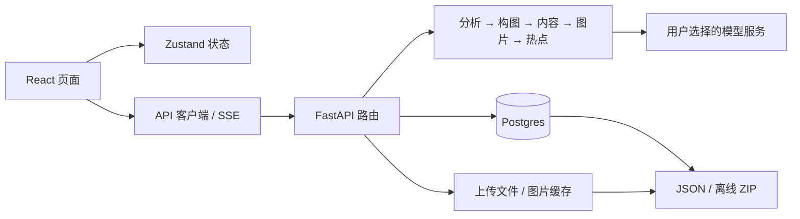

# Flipbook Builder 项目审查

> 历史记录（2026-10-18）。本文保留当时状态；当前实现与可运行命令见[文档导航](../README.md)和[验证说明](../VERIFICATION.md)。旧 PoC / 36 场景 CLI 已退役。

> 这是 `6354b49` 的历史基线审查，保留原始发现供追溯。后续修复与当前验证状态见[第一轮实施报告](IMPLEMENTATION_REPORT.md)，不要将下文待办直接当作当前缺陷。

日期：2026-10-18（Asia/Shanghai）
基线：`6354b49`
范围：项目结构、页面体验、账号与数据访问、密钥、开源准备、现有构建与测试。

本轮按用户确认先完成审查，界面重设计另行进行。未修改业务代码、依赖版本、数据库或部署配置；本文中的修复均为待办，不表示已经修复。检查过程中安装了前端锁定依赖、启动临时本地预览，并使用临时隔离 Python 环境。

## 结论

这是一个已经具备完整主要功能骨架的视觉创作工具，但还没有达到可放心直接部署到公网的成熟度。问题不只是页面粗糙：正式构建失败，上传和离线导出存在脚本注入风险，服务端默认密钥与客户端地址可被混配，部分关键交互和数据一致性需要修复。

项目已经有 MIT `LICENSE`，没有用户表、登录注册路由、OAuth、JWT、会话或角色权限模块。没有需要删除的账号系统。当前实际模型是**免登录、单实例共享工作区**：能访问服务的人可以列出、读取、修改和删除同一批项目。`/v/:projectId` 只是浏览入口，不是独立的权限边界。

建议保留这一简单定位，明确自托管和共享范围，清理不安全的服务端密钥兜底与默认部署暴露，再重做创作体验。开源代码、自托管实例以及公开只读作品是三个不同的概念。

## 1. 项目结构与数据流

| 位置 | 职责 | 当前评价 |
|---|---|---|
| `frontend/src/pages` | 首页、编辑器、浏览器、分享、设置、关于，共 6 个页面组件 | 职责分明，但首页/编辑/预览共用 `/` 与 store 状态切换 |
| `frontend/src/components` | home / builder / viewer / settings / shared | 已有组件拆分，可保留；样式大量散落在内联对象中 |
| `frontend/src/store` | 项目状态、位置恢复、模型配置 | Zustand；项目正文从 API 恢复，密钥直接持久化于 localStorage |
| `frontend/src/api/client.ts` | 普通请求、SSE、导出 | 普通请求统一附带两组模型配置，职责和密钥发送范围需要收紧 |
| `frontend/src/i18n` | 中英词典和语言切换 | 已建立机制，编辑器与操作 hook 中仍有大量中文硬编码 |
| `backend/main.py` | FastAPI、数据库生命周期、CORS、静态文件、配置测试 | 应用入口简单；信任边界和默认配置不足 |
| `backend/routers` | 项目 CRUD、分析、热点、生成、导出 | 两个路由文件共约 945 行，混合编排、数据库写入和传输逻辑 |
| `backend/agents` | 输入理解、构图、页面内容、出图、热点定位 | 模块划分清楚，适合保留并补契约测试 |
| `backend/database.py`、`schema.sql` | Postgres 连接与表结构 | 数据模型有项目/节点/热点，没有账号模型 |
| `backend/storage.py`、`data/` | 上传、生成图片、缓存 | 本地文件持久化，需要加强上传格式与生命周期管理 |
| `backend/templates/viewer.html` | 离线 ZIP 中的独立浏览器 | 有实用价值，但数据嵌入方式必须修复 |
| `docker-compose.yml` | nginx 前端、FastAPI 后端、Postgres | 自托管基础齐全，默认网络暴露不适合无鉴权实例 |

现有基础值得保留：图片/文字双入口、树状内容结构、可编辑热点、生成进度与取消、项目保存、JSON 和离线 ZIP 导出。下一轮不需要把这些功能推倒重写。

## 2. 发布前优先处理的问题

优先级：P1 表示影响凭据、内容完整性、构建或核心任务，应先修复；P2 表示重要体验和维护问题；P3 表示后续整理。以下安全结论不是对已部署系统遭到攻击的判断。

### P1-01：任意客户端地址可以与服务端默认 API Key 混用

**证据：** `backend/agents/base.py:31–44` 独立读取 base URL 和 API Key 请求头，各自回退环境变量；`backend/main.py:53–92` 的配置测试会调用组合后的地址。

**触发条件：** 部署者配置了 `LLM_API_KEY` 或 `IMG_GEN_API_KEY`，请求者仅覆盖相应 base URL、不给自己的 Key。服务端仍取环境变量中的 Key，并发送到请求者指定的地址。常规前端总发空字符串不能阻止直接 HTTP 请求利用这个组合。

**修复：** 简单 BYOK 模式下不使用共享服务端 Key；若保留服务端配置，URL / Key 必须作为不可拆分的配置组使用，客户端不能替换服务端凭据的目的地址。同步限定协议与允许的出站目标；不要仅用 CORS 代替服务端校验。

**验证：** 本地 MockTransport 已确认仅覆盖地址时，假环境 Key 出现在自定义目的地的 Authorization 头；没有真正对外发送。

### P1-02：上传可伪装成图片并成为同源 HTML

**证据：** `backend/routers/projects.py:199–228` 只信任 multipart 的 Content-Type，保存时保留客户端文件名扩展名，而且先保存再调用分析；`backend/main.py:38–40` 用 StaticFiles 提供上传内容。

**触发条件：** HTML 内容以 `image/png` 声明上传，并使用 `.html` 文件名。即使后续模型分析失败，文件已落盘；访问该上传地址时可按 HTML 渲染。同源脚本能够访问此实例的 localStorage，其中包括模型密钥。

**修复：** 服务端实际解码图像并重新编码为白名单格式，生成自己的文件名和扩展名，校验像素尺寸，失败不落盘。上传源隔离和响应安全头可作为补充，不能替代内容校验。

**验证：** 在临时上传目录与模拟数据库中复现：分析因缺少 Key 失败后，文件仍存在，StaticFiles 返回 `text/html` 与脚本内容。

### P1-03：离线 ZIP 的 JSON 可逃出 script 标签

**证据：** `backend/routers/projects.py:495–503` 把 `json.dumps` 的结果直接替换进 `backend/templates/viewer.html:230` 的 JavaScript 上下文。只处理标题中的 `<` 不会保护 payload。

**触发条件：** 项目名、节点文本或热点标签包含 HTML 结束脚本序列。打开导出的 `index.html` 时可形成额外脚本标签。这是离线文件上下文中的脚本执行风险，不应直接等同于站点同源密钥泄露。

**修复：** 对嵌入 HTML 的数据做上下文安全序列化（至少转义 `<` 等字符），或使用安全的数据载入方式；补包含特殊结束标签的导出回归测试。

**验证：** 模拟项目导出的 HTML 经解析后确实出现额外 script 元素；没有打开真实作品或执行外部请求。

### P1-04：标准构建不通过，Docker 构建绕过了检查

**已运行：** `cd frontend && npm run build` 失败。

错误涉及 `Icon.tsx:57` 的 JSX 命名空间、`ZoomTransition.tsx:36` 的 easing 类型、`ViewerPage.tsx:130` 的推导、测试中的 `global` / mock 类型，以及 `vite.config.ts:7` 的 `test` 配置类型。

`npx vite build` 单独执行成功，解释了开发预览和 Docker 打包为何能工作。`frontend/Dockerfile:12` 明确跳过 `tsc -b`，当前没有 CI 兜底。这不代表生产构建已经健康。

**修复：** 修正源文件类型和测试类型配置，让开发、CI、容器统一执行正式 build 命令。

### P1-05：确认弹窗的 Enter 会越过“取消”焦点

**证据：** `frontend/src/components/shared/ConfirmDialog.tsx:60` 初始聚焦取消按钮，但 `:63` 在 window 上把所有 Enter 都映射到 `close(true)`。

**影响：** 键盘用户按 Enter 想激活当前取消按钮时，可能确认删除。源码已核对，本次没有对真实项目执行删除复现。

**修复：** 让原生按钮处理 Enter，保留 Escape 取消，补焦点约束与关闭后焦点恢复。

### P1-06：窄屏编辑器与核心键盘路径不完整

**证据：** `BuilderPage.tsx:74–76` 固定 `280px 1fr 320px` 且隐藏溢出，两侧已经占用 600px；现有媒体查询只折叠首页装饰。上传区、热点勾选、热点导航使用不可聚焦 div；设置输入没有关联 label。

**影响：** 不能通过调整字体和颜色修好：手机需要独立的编辑组织方式，键盘用户需要完整的操作入口。

**修复：** 窄屏采用画布、页面树、热点切换或抽屉；交互使用原生按钮/复选框，表单使用关联标签，补键盘移动热点的替代入口。

### P1-07：浏览模式的热点坐标与图片裁切不一致

**证据：** `ViewerPage.tsx:68` 使用全屏 `object-fit: cover`，`ViewerHotspot.tsx:15–25` 仍将图片坐标百分比直接映射到整个视口。

**影响：** 图片与视口宽高比不同时，裁切偏移未应用到热点，尤其竖屏会点错对象。结论来自几何关系与源码，本轮未通过真实生成内容做端到端验证。

**修复：** 图片和热点共用同一坐标容器，或统一计算 cover 的缩放和偏移。与编辑器、离线导出的坐标规则保持一致。

### P2-01：免登录实例的共享范围没有明确告知

**证据：** 项目列表和 CRUD 均无用户范围；`docker-compose.yml:18,61` 将数据库和前端端口发布到宿主机所有接口；`backend/main.py:31–34` 默认通配 CORS 并启用 credentials。

**修复：** 明确这是共享工作区；默认绑定 loopback，数据库按需暴露；禁用无需使用的 cookie credentials，缩小 CORS。若之后需要把作品分享给不受信任的访客，应拆分只读发布服务或只分享离线包，而不是把编辑 API 一起当作只读服务开放。

这不是要求为开源项目增加登录系统，也不意味着 CORS 能阻止非浏览器客户端访问。

### P2-02：密钥说明、默认供应商和配置行为不一致

- `translations.ts:61` 宣称“密钥仅存浏览器，不上传服务器”，实际 `api/client.ts:7–12,34–36` 会把密钥随请求发送到后端，再由后端转发模型服务。应说明“保存在当前浏览器，调用时经过此实例后端转发”。
- `settingsStore.ts:20` 和后端代码默认图片地址为第三方 `api.apiyi.com`，`.env.example` 与 Compose 则默认 OpenAI 官方地址。应统一默认值，自定义中转由用户明确选择。
- `SettingsPage.tsx:65–89` 切换供应商保留旧 Key，用户测试新供应商时可能把旧供应商 Key 发到新地址。建议凭据按供应商隔离，或切换后清空相应 Key。
- `SettingsPage.tsx:102` 的“测试连接”先持久化配置，与“保存配置”语义冲突。测试应使用未保存草稿。
- 后端支持环境变量配置，但前端 `UploadZone.tsx:33–34`、`useBuilderActions.ts:50–58` 仍强制浏览器 Key；应明确只支持 BYOK，或让前端知道服务器配置能力。
- 没有清除已保存密钥的独立入口；localStorage 保存的是明文，UI 应准确说明保存范围，并提供清除方式。

### P2-03：热点更新与生成缺少一致性保护

- `backend/routers/nodes.py:92–95` 更新热点只使用热点 ID，未同时约束所属节点；URL 中的项目和节点检查并不能验证 payload 内的热点归属。即使共享实例，也不应允许更新错误节点的热点。
- `nodes.py:148–156` 先设 `generating` 再判断是否还有待生成热点，提前结束及失败/取消分支需要恢复状态。
- 子节点、热点与关联写入缺少同一事务；无幂等或并发保护时，重复请求可能留下重复节点或部分写入。这些分支是源码审查结论，尚需在独立 Postgres 中复现。
- `HotspotOverlay.tsx:55` 每次 pointermove 都调用保存链路，`useBuilderActions.ts:254`逐次发 PATCH，没有合并请求或顺序保障；快速拖动会产生大量请求和落盘顺序风险。
- `nodes.py:382–385` 重生成覆盖相同图片文件，而 `frontend/nginx.conf:35–37` 对该 URL 缓存 7 天；图片 URL 未变，客户端可能继续显示旧图。应使用版本化 URL 或内容哈希文件名。

**修复：** 校验热点所属关系；使用事务、明确状态迁移和幂等策略；拖动时先更新本地，结束时保存，失败明确回滚或提示重试。

### P2-04：首次使用丢草稿，恢复路径偏弱

`UploadZone.tsx:28–31` 把文件、文本和关键词放在组件局部状态，点击配置 Key 跳转 `/settings` 后组件卸载，返回需要重填。首页顶栏、橙色横条、主 CTA 三处重复强调配置，右侧示意卡却无法体验真实作品。

`ProjectList.tsx:89–96` 的错误态只有淡色错误文本，无重试；`projectStore.ts:200–206` 将临时网络失败与项目被删除同样处理。应保留草稿，提供无需 Key 的只读示例，并区分网络失败与不存在。

### P2-05：开源维护入口和依赖基线不足

- `frontend/README.md` 仍为 Vite 模板；主 README 的 clone 地址仍为占位符，目录名与实际仓库不同，本地环境变量步骤也不完整。
- 没有 CI、CONTRIBUTING 或独立开发测试依赖清单；后端 requirements 不包含 pytest / pytest-asyncio。
- 后端 `openai`、`Pillow` 使用无上界的版本范围且无锁文件，后续安装结果会漂移；主 `.gitignore` 没有通用覆盖 `.env.production` 等环境文件，应改为忽略环境文件族并明确保留示例。
- 前端 `npm audit` 报告 21 个包级告警：14 high、6 moderate、1 low；仅生产依赖为 2 个 high（react-router / react-router-dom）。其中多个 advisory 针对 SSR / RSC 或开发工具，不能把包数量直接当成当前 SPA 可利用漏洞数量。应逐项核对适用性并分批升级，避免直接使用 `audit fix --force` 引入跨主版本改动。
- `App.css`、React/Vite 模板资源及未接入的 ViewerCanvas / ZoomTransition 需要核实后清理。当前 `main.tsx` 仅引入 `index.css`，旧模板样式不是现有视觉依据。

### P2-06：供应商协议与上传限制尚未对齐

- `backend/agents/input_analysis.py:23–29` 与 `hotspot_localization.py:64–70` 构造 Anthropic 图像块，`base.py:129–148` 的 OpenAI 兼容分支原样发送，缺少 `image_url` 协议转换。不能仅根据可填 OpenAI base URL 就认为图像分析兼容；本轮没有真实供应商调用，应补 mock 请求契约测试。
- 后端在完整 `file.read()` 后才检查 20 MB，无法限制读入时的内存占用；nginx 未配置与前后端宣传的 20 MB 一致的 `client_max_body_size`。需统一代理、应用和界面的上传限制。
- 项目 settings 缺少严格范围约束，`max_hotspots_per_page` 虽保存但未实际用于限制生成，界面和配置承诺需与行为一致。
- `backend/storage.py:68–74` 的 URL 转磁盘路径仅检查前缀，未验证规范化后路径仍留在 uploads。未找到公开 API 可直接写入任意 image_url 的完整利用链，因此仅列为防御性整改，不宣称已证实任意文件读取。

## 3. 设计审查

Method: dual-agent（A: `/root/design_review` · B: `/root/design_evidence`）。A 先独立完成设计判断，再合并 B 的机械扫描和浏览器证据。采用 impeccable 技能；评价模式为 Operate。

### 设计特征与总体判断

“图片 → 热点 → 分层探索”本身有辨识度，树导航和层级关系应成为界面的核心。现在的表达仍以通用 AI 工具的灰白圆角卡、iOS 色板、技术标签和装饰图为主。首页近一半空间展示的是 CSS 示意，而不是可以点进去体验的作品。

粗糙感主要来自四个方面：实际成果没有被展示；配置提示抢占创作主线；尺寸、间距、字体和按钮规则散落；核心交互在键盘、窄屏、错误分支下没有闭环。单纯换色或增加动画不足以解决。

### Nielsen 启发式评分

这是本轮主观设计评审基线，不是自动化质量分数，也不代表安全评级。

| 维度 | 分数 / 4 | 主要依据 |
|---|---:|---|
| 系统状态可见 | 3 | 有生成步骤、进度、耗时；自动保存状态不连续 |
| 符合用户语言 | 2 | 输入/生成易理解；LLM、L0、Base URL 等术语突出 |
| 控制与自由 | 2 | 有返回、取消、确认；无撤销且配置跳转丢草稿 |
| 一致性与标准 | 2 | 有 tokens；可点击 div、按钮及中英内容混用 |
| 错误预防 | 1 | Enter 与取消焦点冲突，测试连接会保存 |
| 识别优于记忆 | 2 | 主按钮明确，双击编辑和悬停操作难发现 |
| 效率与灵活性 | 1 | 有批量生成，核心键盘路径不完整 |
| 美观与简约 | 2 | 基本留白可用，重复配置提示和装饰占位 |
| 错误恢复 | 2 | 有校验和提示，缺重试、回滚与草稿恢复 |
| 帮助与文档 | 2 | 有配置提示，缺创作任务指引 |
| **合计** | **19 / 40** | **核心交互与结构需要改善** |

### 已取得的浏览证据

- 独立新标签检查首页、设置、关于页；桌面 1280×720，手机 390×844 和 320×740。
- 手机首页保留 40px 外边距与 36px 卡片内边距，390px 屏幕的表单可用宽度约 238px；设置页标题、服务商和底部操作按钮出现折行/截断；常见按钮仅约 27–30px 高。
- 这三个页面在所测手机宽度未观察到页面级横向溢出，不能把 Builder 的源码问题泛化为所有页面都有横向滚动。
- 设置页当前显示的 5 个输入都没有关联 label、id 或 aria-label；选项按钮无 aria-pressed，折叠按钮无 aria-expanded。
- 首页上传区在可访问性树中只有文本，没有可聚焦的选择文件按钮。
- 本轮后端未启动，项目列表显示 HTTP 502 是环境条件。可评审的是它无重试、低对比、原始错误码的呈现方式，而不是声称生产服务故障。
- Builder / Viewer 的窄屏、几何、键盘问题以源码证据为主，没有通过真实 AI 生成验证。

### 机械扫描及误报处理

扫描 `frontend/src` 共 15 条提示，涉及 8 个文件：bounce-easing 7、side-tab 6、layout-transition 1、codex-grid-background 1。

| 规则 | 主要位置 | 审查判断 |
|---|---|---|
| bounce-easing | HotspotOverlay:89、ViewerHotspot:29、ConfirmDialog:99、index.css:87/204/436/691 | 不宜全部删除；两个 bounceIn 只有缩放到 1，不能凭名称认定超调 |
| side-tab | settings/Section:41、Toast:99、AboutPage:77/120/226/355 | Toast 边线用于状态反馈有合理用途；About 重复边线卡片可简化 |
| layout-transition | LoadingSpinner:159 | 进度条 width 动画可优化，优先级低于功能问题 |
| codex-grid-background | index.css:91 | 实际编辑画布背景，是产品功能语境中的合理使用 |

浏览器 evaluate 仅允许只读检查，因此未注入检测脚本，未创建可见 overlay。没有将机械提示数量当作缺陷数量。

### 用户风险与应保留的优点

首次用户的情绪低点是：输入内容 → 被要求配置 Key → 理解两组模型 → 返回后草稿消失。键盘和读屏用户在上传和选择热点阶段中断。手机用户面对窄表单、过小目标与不可展开的固定编辑面板。

应保留双输入入口、分步生成、进度/耗时/取消、树状项目结构、共享色彩变量、国际化机制和离线导出。不要因视觉重设计丢失这些已有能力。

## 4. 账号、权限与开源清理清单

| 项目 | 现状 | 下一步 |
|---|---|---|
| 登录/注册/OAuth/角色 | 未实现 | 无代码需要删除，继续保持免登录定位 |
| AI 服务 API Key | 是模型调用凭据，不是项目账号 | 保留必要能力，修复发送目的地与存储说明 |
| 共享数据 | 全实例共享项目，无用户隔离 | README 和部署说明明确范围 |
| 分享链接 | 使用同一项目 API | 不宣称安全只读；公开分享与编辑实例分离 |
| 许可证 | 已有 MIT LICENSE | 保留；依赖和素材的逐项许可审计未纳入本轮 |
| 源码敏感信息 | 当前及两个历史提交的文本模式扫描未发现真实 provider token、私钥或云 token；命中的是示例数据库凭据 | 保留 .env 忽略；这不是对所有类型秘密的完整证明 |
| Docker 构建上下文 | 前后端 .dockerignore 均忽略 .env 和 .env.* | 保留 |
| 默认模型地址 | 前后端代码与 Compose 不一致 | 统一，第三方服务由用户主动配置 |
| 开源贡献流程 | 缺 CI / 贡献指南 / 测试安装说明 | 建立可复现开发与检查流程 |

## 5. 检查结果与边界

| 检查 | 结果 |
|---|---|
| `npm ci` | 成功，未改依赖版本或锁文件 |
| `npm test` | 8 个文件、71 项测试通过；jsdom 打印文档导航未实现提示 |
| `npm run lint` | 通过 |
| `npm run build` | 失败，TypeScript 错误见 P1-04 |
| `npx vite build` | 成功；这是绕过类型检查的打包验证，不替代正式构建 |
| `npm audit` | 21 个包级告警；生产依赖子集 2 个 high |
| 后端 Ruff | 通过 |
| 后端无数据库测试 | `test_composition.py`、`test_image_generation.py`、`test_sse.py`：41 项通过；有 2 条 Python 3.14 / pytest-asyncio 弃用警告 |
| 本地安全复现 | P1-01、P1-02、P1-03 三项均复现，使用假 Key、MockTransport、临时文件和模拟数据库 |
| 数据库集成 / Docker 全链路 | 未运行：Docker daemon 未启动，未连接现有用户数据库 |
| 真实模型调用 | 未运行：没有使用真实 API Key，也没有触发付费生成 |
| 设计浏览与扫描 | 完成桌面/手机三页面检查和一次机械扫描 |

后端验证使用 `/tmp/flipbook-audit-venv` 隔离环境与 `/tmp/flipbook-audit-repro.py`，未改变项目依赖清单。不能将 mock 验证理解为真实部署端到端通过。临时前端预览在审查后关闭。

## 6. 下一轮的执行顺序

1. **建立可发布基线。** 修复密钥混配、上传和 ZIP 注入、确认删除键盘行为以及正式构建；增加有针对性的回归测试和 CI。
2. **整理免登录自托管边界。** 统一 BYOK 策略和默认地址，修正文案，提供清除配置，收紧默认端口/CORS，补安装与贡献文档。
3. **再重做创作流程。** 首页放真实只读示例与项目入口，保留草稿；设置减少首次选择；编辑器以画布为中心，支持窄屏和键盘；统一图片与热点坐标。
4. **最后收敛视觉系统。** 统一字号、间距、按钮和反馈状态，集中样式，清理模板残留和无效组件。用同一套桌面/手机场景验证，而不是继续堆叠装饰与动画。

后续设计需要回答的实质问题是：首次打开是否能先体验作品；手机是否承担编辑还是主要承担浏览；公开分享是否使用独立只读产物。本轮不要求用户再次选方向，按“先审查、下一轮重设计”的决定收尾。
