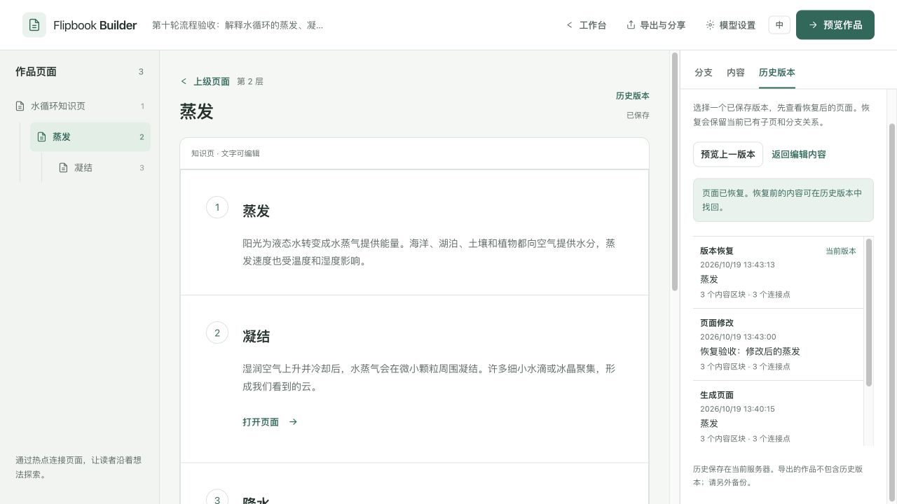
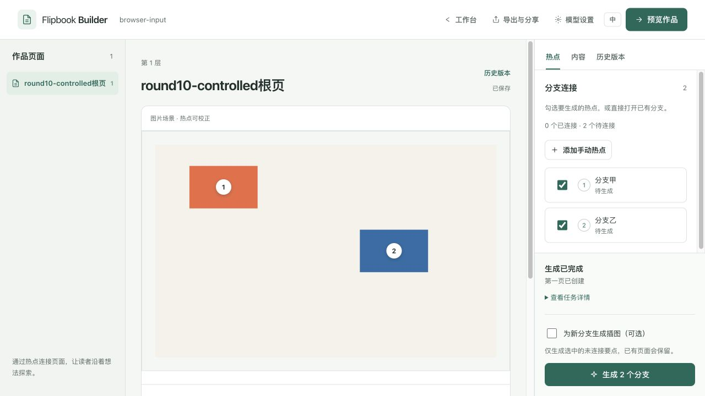

# 第十轮实施：独立保留集与模型无关的生成约束

完成于 2026-10-19，实施前基线 `cd39498a206826b9b87716be419a7148db1b9f67`，分支 `codex/provider-neutral-quality`。按用户补充“现在不需要放具体的模型”，本轮不预置或绑定模型，不执行真实推理。此前的下载准备已终止，本轮临时权重缓存已删除；新增模型运行器改动已撤回，第九轮工具和历史测量保留。

本轮完成的是可选生成约束、独立保留样例和完整功能验收。**受控回放与假供应商 HTTP 不能证明正文、定位或跨页语义有所改善；真实模型质量、Agent 质量评审与人工质量评审均未测。** 新实验默认关闭。实施范围见[计划](ROUND_10_PLAN.md)，可核验摘要见[验收证据](../evidence/round10-verification.json)。

## 生成与恢复

新增显式 `focused-v3`，服务端仅在 `KNOWLEDGE_GENERATION_REVISION=focused-v3` 时启用；未设置或留空继续原行为。CLI 新运行默认 `legacy-v1`，可显式选择 `grounded-v2` 或 `focused-v3`。默认及旧修订完整请求字节的回归校验通过，没有按模型名称推断能力或格式。

正文要求改为按素材深度组织 1–4 个有实质内容的区块，明确读者语言，保留数值、单位、事件起算点、例外、虚构属性与未知事项。子页围绕所选主题解释机制、区别或限制，避免用重复父页或补造时间线填满版面。这些是待真实模型验证的约束目标，不是本轮已测得的效果。

根页、子页和再生在入队时冻结实际修订及有界来源上下文。原始文字与模型生成的概览分开，子页携带所选正文及已覆盖主题。恢复使用任务里保存的标记和上下文，既有 DBOS 名称、步骤与无标记任务兼容路径保留。实验配置错误只阻断新任务；既有幂等操作先返回原任务。

图片采用明确的 `bbox_2d=[left,top,right,bottom]`，0–1000 相对坐标，验证后转换为现有 0–1 左上角加宽高。只在新修订生效；非法、混合、倒置、越界与非有限框拒绝，不猜比例、不截边、不补一次请求。原解析和存储限制保留，英文空结果的说明也遵循当前语言。

## 独立保留集与方法冻结

新增 [`quality-holdout-v1`](../../evals/datasets/quality-holdout-v1/)：虚构地图数字化流程、月相几何及一幅原创多尺度遮挡场景，各中英文，共 6 案例、18 阶段。文件含来源、事实锚点、禁止结论、原创图形与像素支持框、作者录制及 MIT 许可。独立策划者只依据数据合约建立素材，不读取提示词或第九轮真实输出。

保留集于 `2026-10-19T05:15:12+00:00` 冻结，候选于 `05:33:47.547047+00:00` 冻结；实现侧此前只收到数量、摘要及校验状态，候选冻结后才打开具体素材。没有依据保留集修改提示词、适配器或评分方法。完整来源与文件清单由数据集 `FREEZE.json` 验证；像素重建、可见范围和三层可达性校验通过。未来依据这些结果调优时，它将成为回归集，需要另建保留集验证泛化。

| 冻结对象 | SHA256 |
|---|---|
| 生产与运行器 | `4ac1b7089ee046a0074c7ebecc60bb1b1e9fe8960d35671e38a4db341b777c6f` |
| 评估器 | `56587b7e688c4e8b7388564e2930101bdeea8364e1c478be0c633eebd6a1c7f4` |
| 原开发集 | `c58fc124ea4212795bcec5c6f5a9f954387654db121469400e7249321292e5dd` |
| 独立保留集 | `a8ba1f95f5b8dc494d71c174c9475b49cbed36eb74c85687a47b82a8a493576e` |

[候选冻结记录](../evidence/round10-candidate-freeze.json)保存逐文件摘要。最终生产、运行器与评估器摘要仍与冻结时一致。原开发集的素材、用例、选择器、录制，以及第九轮历史输出、源码补丁没有改写。第九轮补丁应在该轮记录的基线检出后复原，不能直接套用到本轮源码上。

## 受控回放与可复现性

评估现在显式冻结生成修订、图片热点上限和评估器摘要；任何恢复身份变化均在请求或检查点写入前拒绝。`max_image_hotspots` 默认 3，接受 1–12，进入项目设置和实际过滤。本轮六组回放均明确设为 5，避免默认 3 个的保留上限丢弃较多目标；不能把这些结果称作默认配置的成绩。

新修订的离线图片回放，会将作者录制的 xywh 等价编码为 bbox_2d，只接受合法录制，不读取真值、不改录制原文件。policy 与每次图片调用保存适配器标记及响应转换前后摘要。**live 不将录制用作模型响应，也不执行这项适配或响应修复。** 数据集加载和摘要仍会读取录制做合约校验。提示词、原答、规范化与诊断分别可查；评分量表和评估器未修改。

| 数据集 | 修订 | 案例 / 阶段 | 执行与自动检查 | Agent / 人工质量 |
|---|---|---|---|---|
| 开发集 | legacy-v1 | 6 / 18 | 通过 | 未审 / 未审 |
| 开发集 | grounded-v2 | 6 / 18 | 通过 | 未审 / 未审 |
| 开发集 | focused-v3 | 6 / 18 | 通过 | 未审 / 未审 |
| 保留集 | legacy-v1 | 6 / 18 | 通过 | 未审 / 未审 |
| 保留集 | grounded-v2 | 6 / 18 | 通过 | 未审 / 未审 |
| 保留集 | focused-v3 | 6 / 18 | 通过 | 未审 / 未审 |

108 次是读取受控录制的 transport 调用，实际模型调用为 0。各修订的作者正文与标签相同，坐标仅等价编码；两次已完成运行恢复均保持运行文件原字节，不新增调用。策略不同的比较显示不可直接比较，分差与优胜者为空。没有给这些作者录制补一份模型质量通过评审。

公开的[保留集旧实验运行](../evidence/round10-holdout-grounded-v2-run.json)和[新实验运行](../evidence/round10-holdout-focused-v3-run.json)保留实际运行字节；其余四组的运行摘要在总证据中，原始本地目录被 Git 忽略。以下仅执行离线回放：

```sh
python evals/datasets/quality-holdout-v1/validate_fixture.py
python scripts/evaluate_quality.py run \
  --suite evals/datasets/quality-holdout-v1 \
  --generation-revision focused-v3 --max-image-hotspots 5 \
  --output evals/runs/holdout-focused
python scripts/evaluate_quality.py run \
  --suite evals/datasets/quality-holdout-v1 \
  --resume evals/runs/holdout-focused
```

换用不同修订或开发集时使用新的目录。具体参数与真实供应商的显式额度入口见[质量评估手册](../MODEL_QUALITY.md)；本轮没有配置真实供应商或给出具体模型推荐。

## 完整流程验收

| 验收 | 最终结果 |
|---|---|
| 后端隔离 Postgres 全套 | 434 / 434 |
| 评估工具 | 163 项及 27 个 subtests |
| 前端 | 37 文件、299 / 299；lint、双环境播放器、构建、发布 runtime 通过 |
| 真实进程持久生成 | 默认 7 / 7，新实验 7 / 7 |
| 真实进程历史与发布 | 10 / 10、10 / 10 |
| 正式 Compose | 四服务重建、HTTP 19 / 19 |
| 独立审查 | 无未解决 P1/P2；默认及旧修订请求字节、非法坐标、live 不适配、冻结恢复边界通过 |

真实进程和浏览器均连接本地受控 HTTP 供应商。后端首次全套为 431 项，补齐最终用例后 434 项全过；早期单独调用测试时缺数据库配置的 5 个 fixture setup 错误已由最终隔离 Postgres 全套覆盖。首次浏览器辅助进程未开 TTY，收到 EOF 后在生成前重启；不计为产品成功或模型调用。最终检查结果对应冻结的生产与评估器版本；部分前端与进程检查早于冻结时间完成，相关源码在之后未改动。

实际浏览器完成以下流程：

- 从主题生成根页，继续两层分支，保存 3 节点、2 连接。编辑子页后恢复最早的生成版本，预览明确保留较新的 1 个连接；恢复后第三层仍可打开。
- 实际下载离线 ZIP，独立检查 3 节点、2 连接、内置作品数据及本地 runtime，没有供应商 Key 或敏感项目字段。ZIP 与固定发布使用不同导出结构，不要求二者 JSON 字节一致。
- 发布文字三页与含图单页两个固定快照。原稿修改后阅读仍显示旧标题；另一次编辑在操作前后分别记录所有发布文件摘要，全部字节相同。
- 图片分析只有一次受控请求，原始 bbox 转换为 `(0.1,0.1,0.2,0.2)`、`(0.6,0.4,0.2,0.2)`；2 个热点显示在预设图形上。此图由测试程序和假供应商共同设计，仅验证协议接通。
- 390×844 视口逐层阅读，阅读页 `scrollWidth=390`，评估报告 `scrollWidth=375`，没有横向溢出。报告醒目标明受控回放与未审状态。
- 停止编辑 API、假供应商及验收 Compose 的 backend/Postgres，独立阅读服务刷新后仍可走完三层、加载 800×500 原图；9 个公开文件的 HTTP 响应字节与磁盘摘要一致。

浏览器产生 4 个受控生成请求；数据库中的 4 个任务均成功，冻结实际 `focused-v3`，跨页上下文版本和原始文字来源匹配。验收结束后，专属服务、随机数据库、临时存储和验收下载均已清理；Compose 四服务恢复运行，数据库和独立阅读服务健康。没有新增 GitHub Actions。





[移动阅读截图](../images/round10-mobile-reader.png)、[移动评估报告](../images/round10-mobile-quality.png)、[隔离后的独立阅读](../images/round10-reader-isolated.png)和[桌面评估报告](../images/round10-quality-report.png)均记录在总证据的文件摘要中。

## 后续使用边界

当前可继续用用户自选兼容服务运行同一评估流程，但在完成真实输出与逐页语义评审前，保持实验默认关闭，不给出质量分数、模型排名或已改善结论。两套各一幅合成视觉图、每例一条分支，覆盖仍有限。固定评估能暴露问题并防止方法漂移，不能替代真实题材、自然图片和实际读者验收。

## 提交前整理与复测

第九轮计划和报告归入[历史目录](ROUND_9_IMPLEMENTATION.md)，保留原始测量，修正相对链接；历史机器证据、源码补丁和截图留在原位。当前指南收敛重复结果说明，比较示例两侧统一显式热点上限。开发集 README 仅更新当前配置与历史入口，素材、用例和录制未动。

提交前重新运行评估测试，163 项及 27 个 subtests 通过；仓库根目录 Ruff、保留集完整校验、文档链接和差异检查通过。生成源码、运行器、评估器与保留集保持冻结摘要，原有后端 434 项、前端 299 项及完整浏览器结果继续对应同一实现，本次文档整理未重复这些验收。具体复测命令和范围写入机器证据的 `pre_commit_cleanup`。
