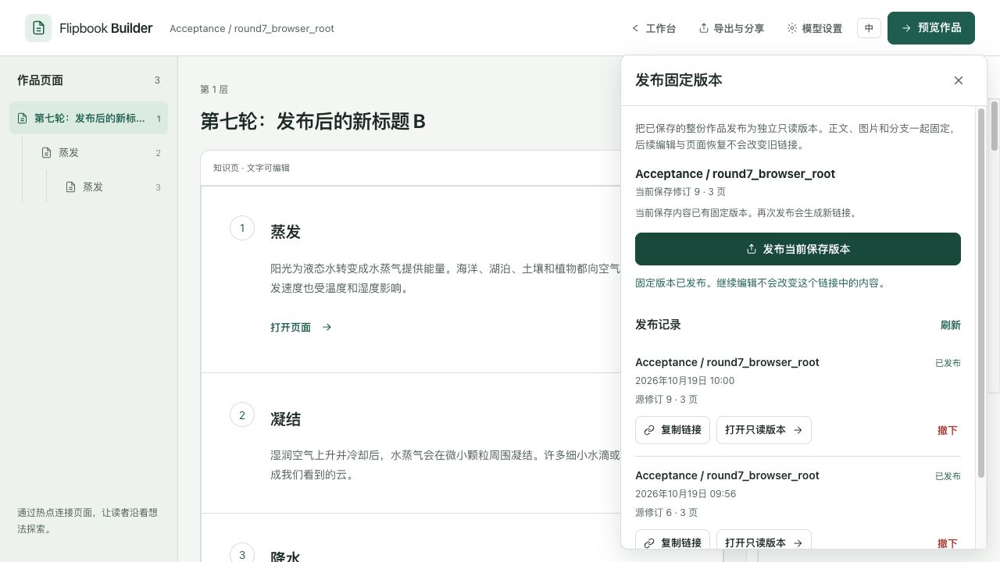
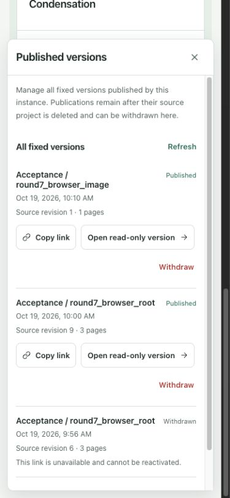

# 第七轮实施：独立只读发布与固定作品快照

完成于 2026-10-19；基线 `c277eb5`，工作分支 `codex/immutable-publications`。[实施前计划](ROUND_7_PLAN.md)与[最终验证汇总](evidence/round7-verification.json)可追溯本轮范围。没有发起付费模型请求。

## 已实现的完整流程

服务器作品从「导出与分享 → 发布固定版本」发布。面板显示当前已保存修订和页数，列出每份发布的时间、源修订、页数与状态；正文、分支、来源、图片和当时的阅读器代码一起固定。新发布生成新地址，旧目录不能覆盖。当前实例预览仍读取实时原作，菜单明确说明它随编辑变化；本地作品继续使用离线 ZIP。

未保存草稿、待保存/失败写入、生成与同步、版本恢复均有具体阻止原因。发布只提交原操作 ID 和已确认修订，不把前端乐观内容上传为快照。会话存储先保留操作，再发请求；丢失响应、服务失败和忙碌重试保留原 ID 与原修订。409 内容冲突明确停止，不自动把后来编辑发布出去。旧列表和跨工作区的迟到响应不能覆盖新结果。

作品库增加全局发布记录。源作品删除后，固定版本仍然存在，也能复制、打开和撤下；删除确认明确说明保留行为。撤下使后续请求返回404，保留私有幂等回执，重试原发布不能重新上线。读者已下载或已渲染的内容无法追回，随机链接不是私密权限。

## 文件快照与独立服务

编辑后端在项目锁和预期修订校验下读取整棵树。发布拒绝活动任务、陈旧修订、孤立/重复目标、不一致的父子/层级、隐藏的不可导航连接、缺失图片、外部图片和符号链接。白名单只保留作品内容、关系、来源及作者声明，不包含密钥、连接配置、原始输入、任务、草稿或历史。

每份 `data/publications/{pub_id}` 保存 `index.html`、`project.json`、可信 `player.js` / `player.css` 及复制的 PNG。图片按内容 SHA-256 命名；私有清单记录源项目、修订、操作、时间、页数及公开文件聚合哈希。发布不新增项目修订，也不调用模型。跨进程文件锁串行管理操作，隐藏暂存完成所有校验与复制后原子 rename 上线，正常失败清理暂存。强制杀进程可能留隐藏暂存，读者不可见；可在停编辑服务后由管理员清理。

Node 构建共享 React 阅读器，Docker 从可信源码构建并复制到后端镜像；客户端不能上传 HTML 或脚本。每份发布再复制自己的阅读器，升级不能改变旧版本。没有与源项目外键级联删除的发布表，源图片删除也不影响复制的文件。

Compose 第四服务 `reader` 使用独立入口 `reader:app`，不导入 main/database/jobs、不加载 `.env`、不创建目录，也不需要数据库或模型配置。运行容器使用 UID10001、只读根文件系统、唯一只读发布目录挂载；没有编辑 API、上传目录和接口文档。只允许精确资源白名单 GET/HEAD 与健康检查，私有清单、隐藏目录、符号链接和路径穿越不可读。响应设 no-store、CSP 与 nosniff；浏览器不可用链接显示双语404，未指向编辑器。

部署与 reader 地址配置见[快速开始](../../README.md#阅读与导出)，精确 API 合约见[后端开发](../../backend/README.md#固定版本发布与独立-reader)，数据边界与备份要求见[当前架构](../ARCHITECTURE.md#来源与发布)。

## 验收与修复

完整本地结果、复测命令与证据索引统一见[验证说明](../VERIFICATION.md)。本轮完成后端 290 项、前端 299 项、发布/历史各 10 场景、生成恢复 7 场景及正式整栈 19 项；双环境播放器、静态检查和四服务构建通过。原始时长、资源哈希及运行容器信息保留在[机器汇总](evidence/round7-verification.json)，不将后续整理结果回写为原始测量。独立代码/视觉审查结论为 ship，material 问题均已修复并确认。

浏览器用真实生成API和受控供应商准备三层知识作品及图片作品，再通过正式编辑UI完成发布A、草稿阻止、保存新标题、历史预览/恢复、再保存并发布B。A始终显示原有标题、资料和已核对声明，B显示新标题与未核对状态，两个链接不同。A发布后部署阅读器边距修复，A保留旧CSS，B使用新CSS，验证代码也随版本冻结。

测试API删除两份合成源作品后，3份发布的所有公开文件哈希仍一致。实际停止本测试Compose的backend与db，确认两者exited，reader仍running；浏览器刷新B后进入第三层，并刷新加载独立160×100 PNG。服务恢复后，全局记录仍能撤下A；旧链接显示[只读404提示](../images/round7-withdrawn.png)，B继续可读。隔离证据见[运行容器与字节哈希](evidence/round7-isolation.json)，过程与构建匹配见[浏览器记录](evidence/round7-browser.json)。

独立审查发现并关闭一个P2：文件锁忙原返回409，前端会丢弃未知结果的操作ID，可能在旧请求最终成功后重复发布。现改503并附Retry-After，保留原操作。前端回归覆盖丢响应、面板重开、工作副本已改、503忙、再次重开及原操作成功，所有请求始终用原修订。

桌面/390px成批视觉检查后修复独立HTML默认8px body margin。补测首页手机长列表发现根滚动条使100vw宽度超出可用区域，独立视觉审查确认P2；修为基于包含块100%，最终375px可用宽度下，面板351px、左右各12px。两项均由新上下文审查者确认resolved，无开放material问题；机械检测一次，结果为空。没有继续扩大视觉改版。

Postgres原始关系文件审计曾遇到列目录后文件被后台清理，已改missing-ok并记录消失数量，历史验收重跑通过。停库健康检查最初假定必须502，实际连接超时；验收改为验证明确不可用，重新停止并比对所有文件后通过。这两次是验证器假设修正，没有将失败结果冒充成功证据。

## 保留边界

本轮只支持服务器作品发布，本地作品以离线 ZIP 分享。单个快照限制1–1000页、内容JSON16MB和图片总量200MB；这些是拒绝边界，不是压力测试或容量承诺。发布依赖支持POSIX flock及原子rename的本地文件系统，不支持对象存储和跨机器多写入者。

资料仍由作者填写，没有自动检索、逐句引用或事实核验。测试证明结构、流程、恢复和固定内容，不证明真实模型知识质量、费用和速度。浏览器验收使用本轮IAB，未进行跨浏览器、真实辅助技术或浏览器file://双击验收；剪贴板只验证成功反馈，不把桥接读回当作系统剪贴板证明。没有多人协作、账号权限、任意跨版本任务迁移或长期负载验收。远端 CI 没有在本轮本地实施中触发。后续已移除 GitHub Actions CI/CD，复测入口统一见当前验证说明。
