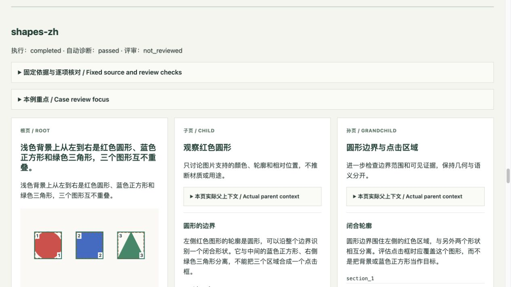

# 第八轮实施与验收：固定样例与模型质量评估

完成于 2026-10-19，基线 `d3dc4b5`，分支 `codex/model-quality-evals`。先制定[计划](ROUND_8_PLAN.md)，再实施独立评估工具；本轮没有修改生产 Agent、提示词、API、数据库或前端产品界面。

后续维护：2026-10-19 按要求移除 GitHub Actions CI/CD，以下原始验收记录保留；检查命令继续供本地运行。

## 已交付

- `evals/datasets/quality-v1/` 固定水循环、虚构预约、三形状图片各中英文版本，共 6 案例。包含原创素材与 MIT 许可、USGS 一手来源锚点、事实与禁止结论、未知项、预设分支、真值框和 18 份作者编写的受控响应。中文与英文图片共用一个独立场景。
- `scripts/evaluate_quality.py` 提供运行、恢复、评审模板、应用评审、静态报告和对比。复用真实生成 Agent 的提示词、解析与规范化，每案根页→子页→孙页。子页仅使用所选父区块完整正文，图片页使用父说明；缺少或歧义分支明确阻断。
- 自动诊断正文空缺/重复、结构与双向分支，以及图片一对一标签与 IoU 定位。事实、热点意义、跨页推进/矛盾和素材约束按来源逐项人工评审，四维 0–4 分各至少 3 分，且逐项核对通过才满足本流程门槛。没有平均总分、自动事实裁判或模型优胜结论。
- 运行、案例、数据集和评估代码摘要绑定评审。失配或漏项不能通过；校准与声明的人工评审分别标记。对比必须满足同样例、方法、预算、覆盖与实际分支；实现变化单独显示。成对报告展示两侧正文、热点与单维评审。
- live 模式要求显式供应商、模型、凭据环境变量和次数/token 预留/时间额度，不读 `.env` 或产品 Key。请求前原子记录意图并预留额度，未知结果停止后续请求，恢复不自动再次调用。默认回放完全离线。
- 运行目录默认不入库，原始输出仅保存在本地私有检查点；报告只展示白名单内容，HTML 转义并禁脚本。重建报告保留已有评审模板，避免覆盖尚未提交的填写内容。

## 首次完整验收

| 验证 | 结果 |
|---|---|
| 质量评估测试 | 89/89，包含数据、运行器、评分/报告与 4 项独立 CLI 进程验收 |
| 既有后端 + 隔离真实 Postgres | 290/290，测试库已清理 |
| Ruff：backend + scripts | 通过 |
| 完整回放 | 两次均 6 案例、18 页、18 调用、66,400 预留输出 tokens；已完成运行恢复仍为 18 调用 |
| 默认离线 | 子进程禁止 socket/DNS，故意设置无用部署 Key 与数据库地址，仍完成全流程 |
| 实际 HTTP 传输 | 本机受控供应商完成 18 请求，验证鉴权、生产提示词、选中区块上下文和密钥回显脱敏 |
| 预算与未知结果 | 次数上限在分发前阻止请求；HTTP 断开后停止全部案例，恢复没有新增请求 |
| 语义门槛负例 | 事实矛盾、禁止结论、低跨页分、漏评或失配均不通过；不靠关键词推定事实 |
| 报告浏览器 | 桌面三列与成对两列；390px 单列；展开来源表与成对正文后无横向溢出；图片完整，脚本 0，控制台错误/警告 0 |
| 独立代码审查 | 修复后 ship |

独立审查修复了两项实质问题：全局评审失配现在使每案评分失效，旧分数不会进入对比；短 Key 的脱敏不再改写内部字段或 `outcome_unknown` 状态，未知请求恢复保持一次分发。另修正缺失图片摘要与生产空上下文一致、保留未完成模板，以及用 `prompt_sources_sha256` 准确标记提示词/适配代码摘要；逐调用的 `prompt_sha256` 仍记录实际请求摘要。

原始测量见[机器证据](evidence/round8-verification.json)，命令与评分方法见[运行手册](../MODEL_QUALITY.md)。本地报告保存在忽略入库的 `evals/runs/round8-baseline/report.html` 与 `evals/runs/round8-comparison/report.html`；新克隆需按手册重新生成。

[390px 手机报告](../images/round8-mobile-quality.jpg)中热点框、来源表和三层正文按单列阅读。

## 提交前清理与复核

统一重复的规范 JSON 摘要逻辑，移除未读集合和无效透传参数；素材、全部案例与数据集摘要保持不变。补充损坏运行文件、空/非法恢复配置和无效评审集合的明确错误，避免 CLI 输出原始异常或对比中断。清理后 94/94 评估测试与 Ruff 通过，新增 5 项输入负例；原始 89 项与后端 290 项完整验收数字保留在上节。

重新运行两次完整回放、已完成恢复、评审模板、报告和成对比较：每次均 6 案例、18 页、18 调用和 66,400 个预留输出 tokens；恢复不增加调用，全部六个作品与原回放逐项相同，真实模型质量仍未审。当前本地报告为 `evals/runs/round8-cleanup-baseline/report.html` 与 `evals/runs/round8-cleanup-comparison/report.html`。源代码与评估方法的新摘要记录在机器证据的 `pre_commit_cleanup`，旧运行记录保持原摘要。

第七轮计划、报告及 7 份 JSON 归档；JSON 与 `d3dc4b5` 原文件逐字节相同。修正两张 JPEG 截图的扩展名，图片字节不变。Docker scratch 构建导出验证运行目录与 Git 元数据不进入构建上下文，生产构建输入仍完整。文档导航和测试指南按当前离线流程更新，GitHub Actions CI/CD 保持移除。此轮没有修改报告布局，原浏览器截图和验收保留。

## 结果的边界

付费供应商调用为 0，真实模型质量仍是 `not_reviewed`，总分为空。回放响应是为验证工具编写的样例，不能视为真实模型输出或知识金标准。每例只有一次输出、一条分支；简单合成图不代表自然图片能力。

次数与预留输出 token 不是实际 token 用量或金额上限。输入、视觉与供应商计价需另行核对；保存的原始输出限 1 MB，但沿用的生产 HTTP 适配器没有流式下载体积限制。严格固定标签可能阻断措辞不同但有用的真实输出，报告必须如实记为未覆盖。

人工评审身份是运行者声明，工具不验证身份或事实本身。测试证明评审门槛有效，不证明任意人工填写正确。自然图片集、多人独立评审校准、真实模型人工基线与统计重复仍需后续开展。既有任务/历史/发布与产品浏览器验收保留[第七轮记录](ROUND_7_IMPLEMENTATION.md)，本轮未重复其完整发布流程；当前检查在本地运行。
